<div align="center">

[English](README.md) · 한국어

<picture>
  <source media="(prefers-color-scheme: dark)" srcset="./assets/readme/acp-logo-dark.svg">
  
</picture>

<br>

[](https://github.com/MongLong0214/agent-control-plane/actions/workflows/ci.yml)
[](docs/STATUS.md)
[](CHANGELOG.md)
[](package.json)
[](docs/adr/ADR-0004-verification-sandbox-isolation.md)
[](tsconfig.json)
[](docs/adr/ADR-0001-runtime-and-persistence.md)
[](#mcp-인터페이스)
[](#라이선스)

**에이전트는 제안하고 증거를 냅니다. 결정은 `agentcpd`가 합니다 — run, 역할, 검증, 블라인드 리뷰, 머지까지.**

[개요](#개요) · [왜 필요한가](#왜-필요한가) · [동작 방식](#동작-방식) · [주요 기능](#주요-기능) · [빠른 시작](#빠른-시작) · [운영](#운영) · [보안](#보안-모델) · [문서](#문서-안내) · [기여](#기여하기) · [라이선스](#라이선스)

</div>

> **상태: 프로덕션 준비 안 됨.** 이 저장소를 운영하거나 여기에 의존하기 전에 [현재 상태](docs/STATUS.md)를 먼저 읽어 주세요.
> 이 페이지는 구현된 것, 테스트로 증명된 것, 실환경에서 관측된 것을 일부러 나눠 적습니다.
> [현재 한계와 증거](#현재-한계와-증거)를 참고하세요.

<h3 align="center">증명하거나 거부합니다 — 슬쩍 낮춰 통과시키지 않습니다.</h3>

<p align="center">
  <a href="#하드-불변식"><picture>
    <source media="(prefers-color-scheme: dark)" srcset="./assets/readme/acp-invariants-ko-dark.svg">
    
  </picture></a>
</p>

<p align="center"><sub><i>불변식은 선택 가능한 정책이 아니라 제품 그 자체입니다. 규범 원문은 <a href="docs/prd/AGENT_CONTROL_PLANE_PRD_v1.3_FINAL.md">control-plane PRD</a> §4에 있고, 각 불변식이 무엇을 지키는지는 <a href="#하드-불변식">아래 표</a>에 정리했습니다.</i></sub></p>

## 개요

Agent Control Plane(ACP)은 로컬 데몬(**`agentcpd`**)과 운영자 CLI(**`agentctl`**)로 이루어져 있으며, AI 코딩 에이전트와 그 에이전트가 고치는 저장소 사이에 자리 잡습니다.
ACP는 코드를 쓰지 않습니다.
대신 에이전트가 자기 작업에 대해 스스로 내려서는 안 되는 결정을 맡습니다.

- **공식 run 상태** — run이 존재하는지, 누가 소유하는지, 끝났는지
- **어느 세션이 어느 역할을 맡는지**, 그리고 그 바인딩이 언제 효력을 잃는지
- 작성자가 손댈 수 있는 **워크트리·브랜치·경로** — 유효한 리소스 claim으로 정합니다
- 후보가 승인된 계약에 맞춰 샌드박스 안에서 **검증**됐는지
- 건드린 모든 파일에 대해 **필수 독립 블라인드 리뷰**를 통과했는지
- 데몬만 접근할 수 있는 GitHub 자격 증명으로 **머지**해도 되는지

CEO, 프로젝트 CTO, 워커, 리뷰어 같은 에이전트는 MCP로 작업을 요청하고 증거를 냅니다.
데몬은 그 내용을 기록하고, 정확히 같은 후보를 기준으로 확인한 뒤 결정합니다.
이 모든 상태는 감독되는 Node 프로세스 하나가 로컬 SQLite 데이터베이스 하나에 담습니다.
HTTP 서버도, 메시지 브로커도, 외부 데이터베이스도 없습니다([ADR-0001](docs/adr/ADR-0001-runtime-and-persistence.md)).

ACP가 지향하는 모습은, 인수(acceptance)를 모두 마쳤을 때 관리 대상 프로젝트의 의도를 검증된 프로덕션 준비 결과로 바꿔 내는 단일 로컬 런타임 권한 주체입니다.
지금 이 체크아웃이 보장하는 범위는 검증 가능한 후보 결과까지입니다.
run을 기록하고, 행동할 수 있는 세션을 바인딩하고, 후보와 계약을 동결해 검증하고, 블라인드 리뷰를 요구하고, 결정 경로를 남깁니다.
범용 자율 에이전트 프레임워크, 호스팅 서비스, 무인 배포 제품, 채팅 라우터는 의도적으로 **아닙니다**.

구현의 규범 입력은 저장소에 함께 실린 [control-plane PRD](docs/prd/AGENT_CONTROL_PLANE_PRD_v1.3_FINAL.md)와 [Repo Factory 통합 PRD](docs/prd/REPO_FACTORY_CONTROL_PLANE_INTEGRATION_PRD_v1.1_FINAL.md)입니다.
[종료 리뷰](docs/review/AGENT_CONTROL_PLANE_v1.0_FINAL_IMPLEMENTATION_CLOSEOUT_REVIEW.md)는 아직 잘못된 부분에 대한 증거로 함께 실려 있습니다.
숨겨 둔 과거 기록도 아니고, 통과한 인수 기록도 아닙니다.

### 역할

논리적 역할은 모두 역할 키로 가리키며, 교체할 수 있는 런타임 세션에 바인딩됩니다([ADR-0003](docs/adr/ADR-0003-role-binding-generation-and-fencing.md)).
역할 목록과 분류는 [`src/domain/types.ts`](src/domain/types.ts) 한 곳에만 선언돼 있습니다.

| 역할 | 역할 키 | 분류 | 책임 |
|---|---|---|---|
| `CEO` | `CEO` | 권한 주체 (`AUTHORITY`) | 작업을 분류하고, run의 실행 모드와 우선순위를 정하고, CTO 에스컬레이션을 해결하고, 프로덕션 준비 여부를 최종 결정합니다 |
| `PRIMARY_CTO` | `PRIMARY_CTO:<projectId>` | 생산자 (`PRODUCER`) | 읽기 전용 탐색, 간결한 계획과 태스크 그래프, 워커 배정, 통합, 수정, CTO 최종 승인을 맡습니다. 프로젝트마다 하나입니다 |
| `BOOTSTRAP_CTO` | `BOOTSTRAP_CTO:<runId>` | 생산자 (`PRODUCER`) | `PROJECT_BOOTSTRAP` run을 PLAN부터 활성화까지 이끕니다 |
| `WORKER` | `WORKER:<taskId>` | 생산자 (`PRODUCER`) | 유효한 claim 아래, 일회용 워크트리에서 범위가 정해진 태스크 하나를 수행합니다 |
| `BLIND_REVIEWER` | `BLIND_REVIEWER:<runId>` | 품질 (`QUALITY`) | 새로 만든 격리 세션에서 패킷만 보고 리뷰합니다. 같은 run의 생산자가 될 수 없습니다 |
| `OPTIONAL_ADVERSARIAL_REVIEWER` | `OPTIONAL_ADVERSARIAL_REVIEWER:<runId>` | 생산자 (`PRODUCER`) | 선택적인 비블라인드 리뷰입니다. run의 생산자 집합에 포함됩니다 |

**오너**는 역할 바인딩이 아닙니다.
오너의 결정은 인증된 인그레스로만 들어오며, 프로바이더 페일오버가 오너 권한을 만들어 내는 일은 없습니다(CP-HI-07).

## 왜 필요한가

모델 세션은 누구나 "끝났습니다", "테스트 통과했습니다", "리뷰했습니다"라고 말할 수 있습니다.
그런데 이 가운데 증거인 문장은 하나도 없습니다.
이런 말을 그대로 받아들이는 시스템은 결국 가장 자신 있게 말한 세션이 믿은 것을 그대로 내보내게 됩니다.
ACP는 이런 주장을 하나하나 메커니즘으로 바꿉니다.

| 에이전트가 할 수 있는 주장 | ACP가 대신 요구하는 것 |
|---|---|
| "run이 끝났습니다." | run을 완료하고, 게이트를 게시하고, 머지하는 것은 `agentcpd`뿐입니다(CP-HI-02). |
| "테스트가 통과했습니다." | 검증은 동결된 후보와 승인된 계약 다이제스트를 대상으로 샌드박스에서 실행돼야 하며(CP-HI-03), 명령을 가둘 수 없으면 실행하지 않고 실패로 닫힙니다([ADR-0004](docs/adr/ADR-0004-verification-sandbox-isolation.md)). |
| "리뷰를 받았습니다." | 독립성은 run에 기록된 바인딩으로, 커버리지는 스냅샷이 건드린 경로로 계산합니다. 파일을 빠뜨린 `PASS`는 `COVERAGE_INCOMPLETE`로 강등됩니다([ADR-0006](docs/adr/ADR-0006-blind-review-independence-and-coverage.md)). |
| "CI가 초록색이고 게이트도 있습니다." | 게이트는 이름이 아니라 생성자 신원, 페이로드 다이제스트, 정확한 head로 신뢰합니다. 그래서 후보 자신의 CI가 `acp-production-gate`를 찍어 낼 수 없습니다([ADR-0005](docs/adr/ADR-0005-trusted-github-credential-and-gate-provenance.md)). |
| "제가 아직 이 run의 CTO입니다." | 바인딩 세대가 펜스입니다. 교체된 세션이 뒤늦게 보낸 결과는 감사 기록만 남기고 버립니다([ADR-0003](docs/adr/ADR-0003-role-binding-generation-and-fencing.md)). |
| "용량은 아마 충분할 겁니다." | `UNKNOWN` 경로는 없습니다. 용량 측정값이 오래됐거나 측정에 실패하면 새 할당을 멈춥니다([ADR-0007](docs/adr/ADR-0007-provider-capacity-and-continuity.md)). |

## 동작 방식

<p align="center">
  <picture>
    <source media="(prefers-color-scheme: dark)" srcset="./assets/readme/acp-architecture-dark.svg">
    
  </picture>
</p>

1. **의도가 run이 됩니다.**
   CEO가 실행 모드(`SIMPLE`, `STANDARD`, `GUARDED`)를 정해 run을 만들고(`run_create`) 디스패치합니다(`run_dispatch`).
   소유자가 정해진 run은 그 세션과 바인딩 세대에 고정됩니다.
2. **역할은 짐작하지 않고 바인딩합니다.**
   바인딩은 세션을 역할 키에 붙이며, 엄격하게 단조 증가하는 `bindingGeneration`을 함께 가집니다.
   이 규칙은 데이터베이스 트리거가 강제합니다.
   이 세대 값은 모든 outbox 봉투, run 소유자 고정, 모든 태스크 실행 receipt, 모든 관리형 쓰기 요청에 실려 다닙니다.
3. **전달은 영속적입니다.**
   데몬이 outbox 행을 쓰고 역할 보유자를 깨우면, 깨어난 턴이 자신의 인증된 MCP 연결로 작업을 읽고 확인 응답(ACK)을 보냅니다(아래 참고).
4. **CTO는 계획하고, 워커는 만듭니다.**
   `plan_submit`이 간결한 계획과 태스크 그래프를 기록합니다.
   워커는 유효한 리소스 claim 아래 일회용 워크트리에서 일하고, ACP가 소유한 쓰기는 관리형 쓰기 가드(Managed Write Guard)를 거칩니다.
5. **후보를 동결하고 검증합니다.**
   검증 명령은 동결된 후보 스냅샷과 승인된 계약 다이제스트를 대상으로 seatbelt 샌드박스에서 실행됩니다.
   환경은 상속하지 않고 새로 구성하며, 프로세스 그룹을 따로 두고, 시간·메모리·출력에 한도를 둡니다.
6. **블라인드 리뷰는 자동입니다.**
   검증을 통과하면 control plane이 새로 만든 격리 리뷰어를 직접 호출합니다.
   CTO나 CEO가 리뷰를 요청하거나 건너뛸 수 있는 연산은 없습니다.
7. **CEO가 결정하고, 데몬이 실행합니다.**
   CTO의 최종 승인이 있고 blocker 발견 사항이 하나도 없으면 데몬이 production-ready 패킷을 조립합니다.
   CEO가 `CONFIRM`하면 데몬의 finalizer가 `acp-production-gate`를 게시하고, 머지하고, 머지 후 검증을 실행합니다.
   GitHub에 가한 효과마다 receipt를 하나씩 남깁니다.
8. **증거는 계속 들여다볼 수 있습니다.**
   `agentctl run export <runId>`는 정규화된 증거 번들을 내보내며, 번들을 만든 호스트가 이를 권위 있게 검증할 수 있습니다([run-evidence export](docs/run-evidence-export.md)).

### run의 수명 주기

<p align="center">
  <picture>
    <source media="(prefers-color-scheme: dark)" srcset="./assets/readme/acp-run-lifecycle-dark.svg">
    
  </picture>
</p>

상태와 허용되는 전이는 [`src/db/schema.sql`](src/db/schema.sql)의 `CHECK` 제약과 전이 트리거로 정의돼 있습니다.
그래서 잘못된 전이는 그 전이를 요청한 코드만이 아니라 데이터베이스도 거부합니다.
run의 종류는 `STANDARD_WORK`, `PROJECT_BOOTSTRAP`, `CONTRACT_CHANGE` 세 가지입니다.

### 전달: outbox, wake, ACK

<p align="center">
  <picture>
    <source media="(prefers-color-scheme: dark)" srcset="./assets/readme/acp-delivery-ko-dark.svg">
    
  </picture>
</p>

재지정(retarget) 여부는 사례마다 판단하지 않고 메시지 종류로 정합니다.
`RUN_DISPATCH`, `TASK_ASSIGN`, `CANCEL_REQUEST`, `CEO_NOTIFICATION` 같은 역할 단위 의도는 새 바인딩으로 옮겨 갑니다.
반면 인계 패키지처럼 특정 인스턴스(incarnation)를 겨냥한 메시지는 오래된 것으로 보고 거부합니다.
진행 중인 인계를 다른 세션에 다시 보내면, 같은 인계를 서로 자기 것이라고 믿는 CTO가 둘 생기기 때문입니다.

### 새 프로젝트: Repo Factory → genesis → 활성화

Repo Factory는 별도 산출물이며, 두 번째 런타임 권한 주체가 되는 일은 없습니다.
ACP는 부트스트랩 계약 가운데 자기 쪽만 구현합니다([ADR-0008](docs/adr/ADR-0008-repo-factory-integration-boundary.md)).

1. **PLAN.**
   Repo Factory가 인라인 genesis 번들(`acp.genesis-bundle.v1`)을 담은 PLAN을 컴파일합니다.
   번들에는 SHA-256 다이제스트가 붙은 초기 파일, `main` / `dev` / `genesis` 브랜치 프로필, 라벨, 마일스톤, 이슈, 제품 의도가 들어 있습니다.
   CI 워크플로는 genesis 파일의 다이제스트에 고정돼야 하고, 매니페스트는 실제 검증 명령을 선언해야 합니다.
2. **첨부.**
   CEO가 최종 바이트를 그대로 검토한 뒤 `bootstrap_plan_attach`와 `expectedSha256`으로 첨부합니다.
   현재 `PRIMARY_CTO`는 그 전에 `bootstrap_plan_stage`로 권한 없는 후보를 올려 둘 수 있습니다.
   첨부는 입력을 전달할 뿐이며, 승인도 실행 권한도 만들지 않습니다.
3. **제출.**
   `BOOTSTRAP_CTO`가 저장된 바이트를 읽고(`bootstrap_plan_get`) 다이제스트로 제출합니다(`plan_submit`).
   ACP는 단계마다 바이트 단위 해시와 바인딩 맥락을 다시 확인합니다.
4. **리뷰와 genesis.**
   부트스트랩 후보는 독립 블라인드 리뷰, 오너 승인, genesis 풀 리퀘스트, 정확한 head에 대한 CI 게이트를 거칩니다.
   매니페스트가 `commitlore.mode: required`를 지정하면 생산자가 새 저장소에서 버전이 고정된 CommitLore CLI를 실행하고(`init` 다음 `doctor`), 관측에 실패하면 게이트를 거부합니다.
5. **활성화.**
   `PROJECT_BOOTSTRAP` run을 완료할 수 있는 것은 ACP의 활성화 결과뿐입니다.
   여기에는 프로젝트 등록, 로컬 바인딩, 주 CTO 바인딩, Buzz, 인계 ACK, doctor가 포함됩니다.
   CEO의 `CONFIRM`은 저장된 활성화 결과 다음에 옵니다.
   활성화 사실을 스스로 주장하는 Repo Factory 결과는 거부됩니다(`BOOTSTRAP_RESULT_OVERCLAIMS_ACTIVATION`).
   프로젝트의 `PRIMARY_CTO`는 언제나 활성화 시점에 새로 바인딩되는 세션이며, 구조화된 인계를 확인(ACK)해야 합니다.

교체 절차와 크기 제한을 포함한 운영자용 단계별 흐름은 [운영 문서](docs/OPERATIONS.md#supplying-a-compiled-bootstrap-plan)에 있습니다.

## 주요 기능

| 기능 | 하는 일 | 위치 |
|---|---|---|
| **Run 엔진** | run, 태스크 그래프, 소유자 고정, 데이터베이스가 강제하는 상태 기계 | [`src/run`](src/run), [`src/db`](src/db) |
| **역할 바인딩과 펜싱** | 단조 증가하는 바인딩 세대. 페일오버는 활성화·전환·취소·재지정을 한 트랜잭션으로 처리 | [`src/session`](src/session), [ADR-0003](docs/adr/ADR-0003-role-binding-generation-and-fencing.md) |
| **outbox, 깨우기, ACK** | 세대 펜스를 둔 역할 보유자 대상 영속 전달. 대기 중인 in-band 행은 다시 깨움 | [`src/outbox`](src/outbox) |
| **관리형 쓰기 가드** | 브랜치·워크트리·경로에 대한 리소스 claim과 리스. 허가는 부작용 직전에 소비 | [`src/guard`](src/guard), [`src/claims`](src/claims) |
| **검증 엔진** | 계약에 고정된 명령을 seatbelt 샌드박스에서 실행. 증거 모드는 `LOCAL_COMMAND`, `TRUSTED_CI`, `BOTH_REQUIRED` | [`src/verify`](src/verify), [ADR-0004](docs/adr/ADR-0004-verification-sandbox-isolation.md) |
| **블라인드 리뷰 게이트** | 패킷만 받는 자동 리뷰어. 독립성과 커버리지를 기계적으로 확인하고, 이그레스는 프로바이더로만 제한 | [`src/review`](src/review), [리뷰어 이그레스](docs/reviewer-egress.md) |
| **GitHub 커널** | 풀 리퀘스트 준비, `acp-production-gate` 게시, 머지, 머지 후 검증, 브랜치 게시, 릴리스 태그. 모두 멱등 receipt로 기록 | [`src/github`](src/github), [ADR-0005](docs/adr/ADR-0005-trusted-github-credential-and-gate-provenance.md) |
| **프로바이더 용량과 연속성** | 프로바이더마다 서로 독립된 신호 세 개, 계획을 먼저 세우는 페일오버, 진행 중인 작업을 선점하지 않는 복원 | [`src/capacity`](src/capacity), [`src/continuity`](src/continuity), [ADR-0007](docs/adr/ADR-0007-provider-capacity-and-continuity.md) |
| **오너 인그레스** | `IngressGuard`가 Telegram과 Buzz에서 선언된 오너와 행위자만 받아들이고 재전송을 차단 | [`src/ingress`](src/ingress), [ADR-0009](docs/adr/ADR-0009-owner-ingress-is-the-front-door.md) |
| **Buzz 어댑터** | `buzz` CLI를 거쳐 Nostr 릴레이 전송으로 펜스가 걸린 봉투를 보내고, 인증된 멘션 구독자를 운영 | [`src/buzz`](src/buzz) |
| **부트스트랩 활성화** | Repo Factory PLAN 접수, genesis 번들 검사, CommitLore 관측, 활성화, 상주 CTO 인계 | [`src/bootstrap`](src/bootstrap) |
| **Doctor와 복구** | 심각도와 `blocking` 여부가 붙은 읽기 전용 점검 결과, 허용 목록에 있는 복구 작업 | [`src/doctor`](src/doctor) |
| **증거 내보내기** | 필드를 통째로 가리는 정규 run·baseline 번들. 번들을 만든 데이터베이스와 대조해 검증 | [`src/export`](src/export), [run 증거 내보내기](docs/run-evidence-export.md) |
| **롤백 페어** | 데이터베이스, 런타임 클로저, launchd 서비스를 묶어 봉인하고 다이제스트로 색인한 세대. 한 단위로 복원 | [`src/deploy`](src/deploy), [`deploy/`](deploy/README.md) |

### MCP 인터페이스

데몬은 상태 디렉터리 안의 오너 전용 Unix 소켓으로 MCP 서버 두 개를 제공하고, `agentctl`을 위한 운영자 소켓을 따로 둡니다.

- **CEO 서버** (`hermes.mcp.sock`) — `run_create`, `run_dispatch`, `run_get`, `run_cancel`,
  `run_priority_set`, `project_get`, `cto_start`, `cto_replace`, `cto_suspend`, `cto_resume`,
  `bootstrap_plan_attach`, `bootstrap_review_evidence_attach`, `bootstrap_review_resume`,
  `ceo_decision_submit`, `escalation_resolve`, `owner_decision_submit`, `repair_execute`,
  `doctor_run`, `continuity_status`, `ceo_notification_ack`, 그리고 데몬이 등록하는
  `cto_binding_bind`, `cto_binding_release`.
- **CTO 서버** (`cto.mcp.sock`) — `session_attest`, `contract_get`, `plan_submit`,
  `bootstrap_plan_stage`, `bootstrap_plan_get`, `bootstrap_review_evidence_stage`,
  `resource_claim`, `resource_release`, `task_worker_provision`, `task_worker_run`,
  `task_execution_get`, `task_receipt_submit`, `result_submit`, `escalation_open`,
  `handoff_submit`, `handoff_ack`, `run_ack`, `role_dispatch_pending`, `role_dispatch_ack`,
  `capacity_get`, `doctor_run`, `blind_review_request`.
  마지막 `blind_review_request`는 거부하기 위해서만 존재합니다. 블라인드 리뷰는 control plane이 호출하기 때문입니다.
  입장이 허용된 `PRIMARY_CTO` 연결에는 `role_wake_endpoint_register`와 `role_owner_message_*` 도구가 추가됩니다.

## 하드 불변식

이 불변식들은 선택 가능한 정책이 아니라 제품 그 자체입니다.
규범 원문은 PRD §4에 있습니다.

| 불변식 | 지켜야 하는 것 |
|---|---|
| CP-HI-01 — 관리형 쓰기 가드 (Managed Write Guard) | ACP가 소유한 매니페스트 활성화, 워크트리 수명 주기, GitHub 쓰기는 가드를 거칩니다. 에이전트의 소스 쓰기는 배정된 일회용 워크트리, 유효한 claim, 세션·태스크 receipt, 런타임 어댑터의 범위 안으로 제한됩니다(개별 파일 시스템 콜이 모두 가드 API 호출인 것은 아닙니다). |
| CP-HI-02 — 단일 런타임 권한 (Single Runtime Authority) | 프로젝트 행위자는 혼자서 run을 완료하거나, 권위 있는 게이트를 게시하거나, 머지할 수 없습니다. |
| CP-HI-03 — 후보·계약 고정 (Candidate Contract Pinning) | 검증은 바뀔 수 있는 대체물이 아니라 승인된 계약 다이제스트와 동결된 후보에 묶입니다. |
| CP-HI-04 — 독립 품질 역할 (Independent Quality Role) | 블라인드 리뷰어는 같은 run의 생산자가 될 수 없고, 최종 CEO 역할은 따로 둡니다. |
| CP-HI-05 — 신뢰된 GitHub 자격 증명 (Trusted GitHub Credential) | 프로덕션 게이트와 프로그램 머지에 쓰는 자격 증명에는 데몬만 접근할 수 있습니다. |
| CP-HI-06 — 정확한 증거 (Exact Evidence) | 검증·리뷰·게이트·머지 증거는 모두 정확히 같은 후보 스냅샷에 묶이며, 소스가 바뀌면 효력을 잃습니다. |
| CP-HI-07 — 위임할 수 없는 사람의 역할 (Non-delegable Human Role) | 프로바이더 페일오버가 오너 권한을 만들어 내지 않습니다. |
| CP-HI-08 — 조용한 품질 저하 금지 (No Silent Degradation) | 누락됐거나, 오래됐거나, 불완전하거나, 실패했거나, 격리되지 않은 증거는 PASS로 보여서는 안 됩니다. |

각 불변식은 위반을 실제로 볼 수 있는 가장 낮은 계층, 즉 타입이 있는 코드와 데이터베이스 제약에서 강제합니다.
정책 엔진에는 맡기지 않습니다([ADR-0002](docs/adr/ADR-0002-invariants-as-types-and-constraints.md)).

## 빠른 시작

아래는 개발용 절차이며, 프로덕션 설치 방법이 아닙니다.

**요구 사항.** macOS가 필요합니다.
검증 샌드박스와 리뷰어 샌드박스가 `sandbox-exec` seatbelt 프로필을 쓰고, CI의 `verify` 잡도 `macos-15`에서 돕니다.
Node는 [패키지 메타데이터](package.json)에 선언된 `^22.18.0 || >=24`를 쓰며, CI는 배포 런타임인 `22.23.2`로 돌립니다.
`pnpm`도 필요합니다.

```bash
pnpm install
pnpm rebuild better-sqlite3
pnpm build
pnpm test
pnpm trace
node scripts/ssot-report.mjs
```

`pnpm install`은 이 프로젝트 자체의 `postinstall` 스크립트로 네이티브 애드온도 빌드합니다(`native/peercred`는 Darwin 전용이며, 다른 플랫폼에서는 아무것도 하지 않습니다).
자세한 내용은 [ADR-0010](docs/adr/ADR-0010-native-addon-build-and-load-convention.md)을 참고하세요.
`pnpm rebuild better-sqlite3`를 따로 명시적으로 실행하는 이유는, 그 의존성에 이 단계를 요구하는 pnpm 빌드 승인 게이트가 이 프로젝트 자체의 `postinstall`에는 적용되지 않기 때문입니다.
pnpm은 프로젝트 자체의 `postinstall`을 항상 실행합니다.

푸시하기 전에는 CI가 돌리는 것을 그대로 돌려 보세요.

```bash
pnpm gates
```

이것이 CI `verify` 잡의 게이트 순서입니다.
모든 검사를 정해진 순서대로 실행하고, 처음 실패한 곳에서 멈추며, 게이트마다 종료 코드를 출력합니다.
순서는 [`scripts/lib/prepush-gates.mjs`](scripts/lib/prepush-gates.mjs)에 정의돼 있고, 워크플로도 같은 실행기를 호출합니다.
여기 있는 게이트는 하나하나가 제품 결함을 막거나 커밋 기록을 온전히 지킵니다.

### 프로젝트를 변경하지 않고 살펴보기

빌드한 뒤 CLI 표면과 데몬 잠금 상태를 확인합니다.

```bash
node dist/cli/agentctl.js help
node dist/cli/agentctl.js daemon status
node dist/cli/agentctl.js project register my-project /abs/path/to/checkout
node dist/cli/agentctl.js doctor
```

`daemon status`는 운영자 소켓으로 데몬에 묻습니다.
여기에는 `ACP_OPERATOR_TOKEN`이 필요하며, 데몬이 응답하지 않거나 토큰이 없으면 로컬 잠금 파일을 대신 읽습니다.

### 일회용 포그라운드 데몬

`agentcpd`는 MCP 토큰과 그와 다른 운영자 자격 증명이 없으면 시작하지 않으며, 두 값이 같아도 시작하지 않습니다.

```bash
export ACP_MCP_TOKEN="$(openssl rand -hex 32)"
export ACP_OPERATOR_TOKEN="$(openssl rand -hex 32)"
node dist/daemon/agentcpd.js
```

기본 상태 루트는 `~/.agent-control-plane`이며, SQLite 상태, 워크트리, 용량 기록, 비밀 디렉터리가 이곳에 있습니다.
민감한 로컬 상태로 다루고, 프로젝트 체크아웃 안에 두거나 커밋하지 마세요.
데몬은 오너, 프로바이더, Buzz, 인그레스 설정을 일부러 추측하지 않습니다.
이 가운데 무엇이든 설정하기 전에 [운영 문서](docs/OPERATIONS.md)를 읽으세요.

## 운영

### launchd로 실행하기

릴리스를 빌드하고, 두 자격 증명을 로그인한 사용자의 키체인에 넣은 뒤, 렌더링 설치 스크립트로 사용자 단위 작업을 설치합니다.
모든 플래그와 거부 조건은 [`deploy/README.md`](deploy/README.md)에 있습니다.

```bash
pnpm build
security add-generic-password -U -s com.agentcontrolplane.agentcpd -a ACP_MCP_TOKEN -w
security add-generic-password -U -s com.agentcontrolplane.agentcpd -a ACP_OPERATOR_TOKEN -w
# install과 upgrade에는 Buzz wrapper가 실제로 평가하는 정책 파일의 절대 경로가 필요합니다.
export ACP_BUZZ_SEND_POLICY_FILE=/absolute/path/to/buzz-send-policy.json
deploy/install-launchd.sh install --app-root "$(pwd)" --node "$(command -v node)"
```

두 토큰은 오너 전용 런처가 `agentcpd`를 시작하기 직전에만 꺼내 옵니다.
plist에 저장되지 않고, 에이전트 세션에 상속되지도 않습니다.
저장소에 들어 있는 plist 템플릿을 직접 로드하지 **마세요**.
템플릿에는 아직 채워지지 않은 배포 값이 있고, 그 값은 `deploy/render-launchd-plist.mjs`가 호스트마다 채웁니다.
렌더링한 설치본은 [#400](https://github.com/MongLong0214/agent-control-plane/issues/400)에서 실제 호스트로 검증됐습니다.
특정 호스트의 실제 상태는 짐작하지 말고 `deploy/install-launchd.sh status`로 확인하세요.

```bash
deploy/install-launchd.sh status
deploy/install-launchd.sh restart        # 그 밖에: start, stop, uninstall
deploy/install-launchd.sh upgrade --app-root /absolute/release --node /absolute/node
```

`start`와 `restart`는 이번 시작이 시작 완료 기록을 쓰고, launchd가 안정화 구간 동안 같은 실행 pid를 보고한 뒤에야 성공을 알립니다.
`upgrade`는 렌더링된 plist와 런처를 저장해 두며, 데이터베이스는 순서가 정해진 스키마 단계를 실행하기 전에 일관된 마이그레이션 전 백업을 만듭니다.
`uninstall`은 LaunchAgent plist와 런처만 지우고, 데이터베이스와 백업은 남겨 둡니다.

### 봉인된 페어로 롤백하기

롤백은 **봉인된 롤백 페어** 하나를 복원합니다.
롤백 페어는 `~/.agent-control-plane/rollback-pairs/` 아래에 UUID 이름으로 만들어진 디렉터리입니다.
여기에는 WAL까지 포함한 데이터베이스 백업, 그 데이터베이스를 읽는 런타임 클로저, 그 런타임을 시작하는 launchd 세대가 정확한 목록, 그리고 자기 자신은 제외한 `SHA256SUMS`와 함께 들어 있습니다.
`latest`도 없고 따로 고른 백업도 없습니다.
각각 따로 고른 두 반쪽은 페어가 아닙니다.

```bash
deploy/install-launchd.sh rollback --pair-id <uuid> \
  --expected-index-digest sha256:<hex> \
  --expect-schema-version <n> --expect-service-generation <name> --expect-node-version <vX.Y.Z>
```

`--expected-index-digest`는 페어 **바깥에** 보관해 둔 `SHA256(SHA256SUMS)`입니다.
자기 색인을 스스로 보증하는 페어라면, 자신을 위조한 페어도 똑같이 쉽게 보증하기 때문입니다.
페어는 `node dist/deploy/rollback-pair.js seal …`로 봉인하며, 전체 절차는 [오너 작업 문서](docs/ops/owner-actions.md)에 있습니다.

### 상태와 증거 확인하기

`agentctl doctor`는 운영자 소켓으로 실행 중인 데몬에 보고서를 요청하며, 여기에는 `ACP_OPERATOR_TOKEN`이 필요합니다.
데몬은 doctor 점검을 할 때마다 감사 로그에도 남기므로, 데몬에 묻지 않고도 최신 보고서를 읽을 수 있습니다.
보고서에는 `status`와, 발견 사항마다 붙은 `severity` 및 `blocking` 여부가 들어 있습니다.

```bash
sqlite3 ~/.agent-control-plane/state.sqlite \
  "select at, evidence_json from audit_events where kind='DOCTOR_REPORT' order by at desc limit 1;"
```

원본 데이터베이스를 건드리지 않고 증거를 내보낼 수 있습니다.

```bash
node dist/cli/agentctl.js run export <runId>
node dist/cli/agentctl.js baseline export --from <ISO-8601> --to <ISO-8601>
```

번들은 재현할 수는 있지만 스스로를 증명하지는 못합니다.
권위 있는 검증에는 번들을 만든 호스트의 데이터베이스가 필요합니다([run 증거 내보내기](docs/run-evidence-export.md)).

### 권한 경계

권위 있는 상태 변경, 프로덕션 게이트 게시, 프로그램 머지는 `agentcpd`가 맡습니다.
`agentctl`은 클라이언트일 뿐입니다.
자체 데이터베이스를 열지도, 자체 control plane을 만들지도 않으며, 변경 요청은 인증된 운영자 소켓을 거쳐 잠금을 쥔 데몬에 전달됩니다([#393](https://github.com/MongLong0214/agent-control-plane/issues/393)).
도구와 모델 세션은 요청과 증거를 낼 뿐, 작업이 끝났다고 결정하지 않습니다.

## 보안 모델

| 경계 | 지키는 방법 |
|---|---|
| **자격 증명** | GitHub 권한 자격 증명은 어느 프로젝트 저장소에도 속하지 않는 로컬 비밀 저장소에 있고, 데몬만 읽습니다. CTO, 워커, 리뷰어, 검증 하위 프로세스, Repo Factory, Buzz·Telegram 어댑터의 환경에는 절대 들어가지 않습니다. `ACP_MCP_TOKEN`과 `ACP_OPERATOR_TOKEN`은 서로 다른 값이며, 키체인에 보관하고 plist에는 저장하지 않습니다. |
| **로컬 표면** | MCP 소켓과 운영자 소켓은 오너 전용(`0700`) 상태 디렉터리에 있고, 데이터베이스 파일 권한은 `0600`입니다. |
| **검증** | 언어 제한이 없습니다. 고정된 매니페스트가 선언한 명령만, 샌드박스 밖에서 확인한 절대 경로로, 일회용 워크트리에서 실행합니다. 환경은 상속하지 않고 새로 구성하며 토큰이나 에이전트 소켓 포인터를 담지 않습니다. `HOME`은 데몬의 홈, `TMPDIR`은 scratch입니다. seatbelt 프로필은 읽기를 열고, 외부 네트워크와 로컬 IPC는 `network: "allow"`를 선언한 명령에만 엽니다(기본값 `"deny"`는 IP 네트워크와 워크트리·scratch 밖의 모든 유닉스 소켓을 막으므로 내려받을 수 없습니다). 쓰기는 워크트리·`TMPDIR`·지정된 툴체인 캐시로 제한하며, 지정된 비밀 경로의 읽기·쓰기·소켓 접근을 막습니다(최선의 노력이며 완전한 차단은 아닙니다). pid와 시작 시각으로 프로세스 신원을 잡아 둔 채 시간·RSS·출력에 한도를 둡니다. 가둘 수단이 없으면 명령을 실행하지 않습니다. |
| **블라인드 리뷰어** | 조합된 seatbelt 프로필이 루프백 CONNECT 프록시 포트 하나만 남기고 원격 TCP·UDP를 모두 막습니다. 호출마다 선택된 프로바이더의 엔드포인트만 담은 허용 목록을 새로 만듭니다. 리뷰어가 증명(attest)하기 전에 허용·거부·직접 소켓 프로브를 실행하며, 하나라도 실패하면 `ISOLATION_LOST`입니다. |
| **머지 게이트** | `merge_evaluate`는 게이트가 신뢰된 신원으로 만들어졌고, 페이로드 다이제스트가 로컬에 기록된 게시 내용과 일치하며, head가 머지하려는 정확한 head와 같을 때만 받아들입니다. 브랜치 보호는 심층 방어입니다. |
| **인그레스** | 오너의 결정과 행위자 메시지는 `IngressGuard`가 선언된 신원과 대조해 받아들이며, 들어오는 메시지에는 재전송 방지가 걸려 있습니다. |

검증 명령에는 실행 파일 허용 목록이 없습니다(2026-10-31 오너 지시). argv[0]에는 어떤 실행 파일이든 올 수 있습니다. 선언된 명령은 어느 것이든 시작한 뒤 셸을 실행할 수 있어서, 목록은 원래 경계가 아니었습니다.
실제 경계는 seatbelt와 리소스 샌드박스이며, 셸 내부 회귀 증명은 [`tests/unit/handoff-p1-boundaries.test.ts`](tests/unit/handoff-p1-boundaries.test.ts), 비밀 경로 가드의 증명은 [`tests/unit/the-verification-sandbox-opens-to-every-language.test.ts`](tests/unit/the-verification-sandbox-opens-to-every-language.test.ts)에 있습니다.
샌드박스의 읽기 제한은 화이트리스트가 아니라 지정된 비밀 경로의 거부 목록이며([설계 결정](docs/design-decisions.md)), 최선의 노력입니다. 목록 밖에 둔 자격 증명은 읽힙니다([ADR-0004](docs/adr/ADR-0004-verification-sandbox-isolation.md)).

**명시된 잔여 위험** ([SECURITY.md](docs/SECURITY.md), [STATUS.md](docs/STATUS.md)):

- 데이터베이스 쓰기 가드는 협조하는 프로세스를 전제로 합니다.
  같은 OS 사용자로 코드를 실행하는 프로세스는 상태 데이터베이스를 열어 가드 함수를 지우거나 흉내 낼 수 있습니다.
  `0600` 권한은 다른 사용자를 막아 주지만, SQLite 안에는 소유 사용자를 막는 장치가 없습니다.
- 강제 동작은 Darwin에서만 실제 동작으로 검증됐습니다.
  Linux 하드 메모리 경로는 이 저장소의 CI에서 한 번도 실행된 적이 없습니다.
- 하위 프로세스 격리에는 관측 창이 있습니다.
  그 창 안에서 생성되고 부모가 바뀐 자식 프로세스는 보이지 않습니다.
  이는 한계로 받아들여졌고, 이를 검사하던 테스트는 건너뜁니다([#461](https://github.com/MongLong0214/agent-control-plane/issues/461)).
- 신뢰할 수 없는 저장소나 무인 배포를 위한 완전한 보안 경계로 이 저장소에 기대지 마세요.

취약점은 비공개로 알려 주세요. 자세한 방법은 [보안 제보 안내](docs/SECURITY.md)에 있습니다.
공개 이슈에 자격 증명, 비공개 저장소 자료, 실제로 동작하는 공격 방법을 올리지 마세요.

## 현재 한계와 증거

관측되지 않은 경로에 대해서는 실환경 인수를 주장하지 않습니다.
닫힌 선행 이슈는 실환경 관측이 아닙니다. [`evidence/`](evidence/)에 있는 기록만 관측으로 칩니다.

- **실환경 기록 있음:** GitHub App 게이트 게시, 데몬 finalizer의 머지, 정확한 머지 후 검증([기록](evidence/p0-14-live-gate-merge-postmerge.json)).
  그리고 실제 GitHub 상태를 읽어 신뢰할 수 없는 동명 게이트, 누락된 게이트, 오래된 게이트를 거부한 기록([기록](evidence/p0-14-live-gate-refusals.json)).
  프로덕션 게이트를 게시하려면 GitHub App이 필요합니다.
  GitHub는 개인 액세스 토큰으로 체크 런을 만들 수 없게 하므로, `acp-production-gate`에는 `checks:write` 권한을 가진 설치가 필요합니다.
- **수동 실행 기록 있음:** 실제로 복제한 저장소와 실환경 어댑터로 돌린 SIMPLE, STANDARD, GUARDED run(`evidence/e2e-real-project*.json`).
  이 run을 구동하는 테스트는 기본적으로 꺼져 있어서(`ACP_COMPONENT_INTEGRATION=1`), 이 경로의 회귀는 CI가 잡지 못합니다.
- **`PARTIAL`로 기록:** 설치된 `buzz` CLI와 배포의 인그레스 정책을 거쳐 프로덕션 릴레이로 수행한 Buzz 전달과 확인 응답.
  다만 배포된 데몬이 아니라 메모리 안의 control plane에서 실행했기 때문에, 그 doctor 결과는 호스트가 아니라 해당 테스트 픽스처를 설명합니다([기록](evidence/p0-09-buzz-live-delivery.json)).
- **기록 없음:** [1.0.0 변경 이력](CHANGELOG.md)은 그 릴리스가 아직 하지 못한 일을 적어 두었습니다.
  실제 저장소 두 곳에 대한 머지 순서, 프로젝트 3개·수명 주기 30회의 관측 창, Telegram 실환경 왕복입니다.
  이 가운데 어느 것도 `evidence/`에 기록이 없습니다.
- **리뷰어 이그레스:** 패킷만 보는 블라인드 리뷰어에는 측정을 거쳤고 실패하면 닫히는 프로바이더 프록시 경계가 있습니다.
  다만 배포 수준의 증거 요구는 아직 남아 있다고 [SECURITY.md](docs/SECURITY.md)에 기록돼 있습니다([리뷰어 이그레스](docs/reviewer-egress.md)).
- **검증 입력:** 새 워크트리에는 커밋된 파일만 있습니다. `node_modules`도 빌드 결과물도 없습니다.
  `network: "allow"`를 선언한 명령은 의존성 조회와 다운로드를 위해 네트워크가 열려 있고 `HOME` 아래 지정된 툴체인 캐시에 쓸 수 있으므로, 필요한 것을 직접 설치할 수 있습니다. 기본값 `network: "deny"`인 명령은 아무것도 내려받을 수 없습니다. 내려받을 필요가 없는 길은 의존성 없는 검증 명령(이 저장소의 `scripts/verify-reason-codes.mjs`가 그런 예입니다)이나, 승인된 워크플로 다이제스트에서 나온 CI 결과를 정확한 후보 head에서만 받아들이는 `evidenceMode: "TRUSTED_CI"`입니다.
  프로젝트 매니페스트에서 `network: "allowlist"`는 여전히 지원하지 않습니다.
- **테스트 커버리지의 의미:** `pnpm trace`는 PRD와 새로 실행한 Vitest 결과로 [추적성 증거](evidence/traceability.md)를 만듭니다.
  이것이 재는 것은 선언 커버리지, 즉 라벨이 붙은 테스트 항목이 실행돼 통과했는지입니다. 동작 커버리지나 프로덕션 진입점 커버리지는 재지 않습니다.
- **백로그(아직 출시 전):** 신뢰할 수 없는 저장소를 위한 강한 격리, 웹 대시보드, REST/GraphQL, 자동 Level 6 라우팅 승격(PRD §43).

각 실환경 기록은 캡처 당시의 트리를 설명하며, 지금의 트리와 같다는 보장은 없습니다.
경계 지도는 [현재 상태](docs/STATUS.md)에, 의존 순서와 최종 프로그램 게이트는 [로드맵](docs/ROADMAP.md)에 있습니다.

### 영속성과 용량

상태는 WAL과 `synchronous=FULL`로 연 SQLite 데이터베이스 하나에 있으며, 명시적인 `BEGIN IMMEDIATE` 트랜잭션 안에서 동기적으로 접근합니다.
PRD §30.1에 이름이 나온 테이블 외의 테이블은 모두, §40이 요구하는 대로 그 테이블이 필요한 이유(수명 주기, 무결성 제약, 쿼리)를 [`src/db/schema.sql`](src/db/schema.sql) 안에 적어 둡니다.
한 번 작성한 마이그레이션은 바뀌지 않으며, 바뀌면 `pnpm migrations:check`가 실패합니다.
이벤트 소싱, 감사 해시 체인, 범용 정책 DSL, 분산 합의, 클라우드 데이터베이스는 모두 의도적으로 두지 않았습니다(§30.4).

용량은 각 프로바이더 CLI의 대화형 `/usage` 화면으로 수집합니다.
수집기는 남은 할당량이 명시된 값만 받아들이며, 신뢰 확인 프롬프트, 활동량만 담긴 출력, 타임아웃, 파서 실패에서는 실패로 닫힙니다.
데몬의 JSON 미러는 운영자 입력이 아닙니다.
`UNKNOWN` 경로는 없습니다. 자세한 내용은 [프로바이더 용량 출처](docs/capacity-source.md)를 참고하세요.

## 남은 작업은 어디에 있나

GitHub 이슈 트래커가 단일 진실 공급원입니다.
독립 리뷰 라운드에서 나온 모든 발견 사항, 빌드만으로는 충족할 수 없는 모든 PRD §42 인수 항목, 모든 배포 선행 조건, 모든 의도적 트레이드오프가 이슈로 관리됩니다.
[트래커 색인](https://github.com/MongLong0214/agent-control-plane/issues/306)과 [열린 이슈](https://github.com/MongLong0214/agent-control-plane/issues?q=is%3Aissue%20state%3Aopen)에서 시작하세요.
이 페이지는 트래커의 개수나 상태를 옮겨 적지 않습니다.
`node scripts/ssot-report.mjs`는 트래커를 리뷰 증거, 선언된 작업 항목과 대조해 빠진 것이 있으면 0이 아닌 코드로 종료합니다.
이 스크립트가 확인하는 것은 트래커 연결이지, 코드 변경이 의미상 올바른지가 아닙니다.
[인수 원장](docs/ACCEPTANCE.md)을 참고하세요.

## 문서 안내

| 문서 | 내용 |
|---|---|
| [현재 상태](docs/STATUS.md) | 아직 프로덕션 준비가 안 된 부분, 남은 실환경 작업, CI가 검증하지 않는 경로 |
| [로드맵](docs/ROADMAP.md) | 의존 순서와 최종 프로그램 게이트 |
| [운영](docs/OPERATIONS.md) | 로컬 빌드, 점검, 포그라운드 데몬, wake 소켓, 부트스트랩 PLAN 전달 |
| [launchd 배포](deploy/README.md) | 설치, 업그레이드, 롤백 페어, 오프라인 프로젝트 중지 |
| [오너 작업](docs/ops/owner-actions.md) | 오너가 직접 해야 하는 단계와, 그 직전까지 준비해 둔 절차 |
| [보안](docs/SECURITY.md) | 보안 태세, 명시된 잔여 위험, 비공개 제보 |
| [리뷰어 이그레스](docs/reviewer-egress.md) | 블라인드 리뷰어의 프로바이더 전용 네트워크 경계 |
| [프로바이더 용량 출처](docs/capacity-source.md) | 용량 측정값이 라우팅에 쓰일 수 있게 되는 조건 |
| [run 증거 내보내기](docs/run-evidence-export.md) | 번들 형식, 신뢰 기준점, 가리기 규칙 |
| [CTO 바인딩 위임](docs/cto-binding-delegation.md) | 오너가 부여하는 프로젝트 범위의 `PRIMARY_CTO` 바인딩 권한 |
| [설계 결정](docs/design-decisions.md) | 의도적 트레이드오프와 각각의 재검토 조건 |
| [ADR](docs/adr/) | ADR-0001~ADR-0010: 런타임, 불변식, 펜싱, 샌드박스, 자격 증명, 리뷰, 용량, Repo Factory, 오너 인그레스, 네이티브 애드온 |
| [PRD](docs/prd/) | control plane과 Repo Factory 통합의 규범 요구 사항 |
| [종료 리뷰](docs/review/README.md) | 저장소에 함께 실린 독립 구현 리뷰 |
| [인수 원장](docs/ACCEPTANCE.md) | PRD §42 대비 상태와 트래커 쿼리 |
| [용어](docs/TERMINOLOGY.md) | 뜻이 엇갈리는 용어의 기준 정의 |
| [추적성](evidence/traceability.md) | 요구 사항 → 시나리오 → 실행 가능한 테스트. `pnpm trace`가 생성 |
| [티켓 DAG](docs/tickets/tickets.json) | 원자 단위 티켓과 마일스톤 |
| [변경 이력](CHANGELOG.md) | 각 릴리스가 무엇인지, 그리고 아직 무엇을 하지 않는지 |

## 기여하기

먼저 [기여 안내](docs/CONTRIBUTING.md)를 읽으세요. 요약하면 다음과 같습니다.

```bash
pnpm hooks:install   # 이 저장소의 훅을 .git/hooks에 연결
pnpm hooks:check     # 각 훅이 명시한 경우를 실제로 거부하는지 확인
pnpm gates           # CI verify 순서를 로컬에서 실행
```

- 변경은 추적 중인 발견 사항이나 문서화된 요구 사항에 연결하고, 그 변경으로 만들어지지 **않는** 실환경 증거가 무엇인지 밝혀 주세요.
- 강제 장치를 추가하거나 고쳤다고 주장하는 변경에는 **뮤테이션 증명**이 따라야 합니다.
  강제 장치를 지우고, 지목한 테스트가 밝힌 이유로 실패하는 것을 보인 뒤, 다시 되돌리세요.
- 생성된 추적성 증거나 상태 개수를 손으로 고치지 마세요.
  바뀌는 숫자를 적는 문서는 그 숫자를 명령, 쿼리, 생성된 산출물에서 가져와야 합니다.
- 로컬 테스트, 픽스처, 모델링한 어댑터, 템플릿을 GitHub·Buzz·Telegram·launchd·프로바이더·오너의 실환경 증거처럼 내세우지 마세요.
- 커밋 메시지에는 외부 작업 세션 페이지 링크를 넣을 수 없습니다. `commit-msg` 훅과 `pnpm trailers`가 이를 거부합니다.
- 풀 리퀘스트는 `pnpm merge <number> --subject <text> --body-file <path>`([`scripts/merge-pr.mjs`](scripts/merge-pr.mjs))로 머지합니다.
  이 스크립트는 정확한 head에서 필수 `verify` 실행 결과를 확인하고, 일반 merge commit으로만 머지한 뒤 부모·tree·브랜치 커밋의 CommitLore notes가 origin에 있는지 다시 읽어 확인합니다.

## 라이선스

이 저장소에는 **공개된 라이선스 부여가 없습니다**.
공개 저장소라는 사실을 재사용, 재배포, 배포를 허락한다는 뜻으로 받아들이면 안 됩니다.
이용 조건은 [저장소 소유자](https://github.com/MongLong0214)에게 문의하세요.
체크아웃에는 의도적으로 `LICENSE` 파일을 두지 않았습니다.
릴리스 이력은 [변경 이력](CHANGELOG.md)에, 인수와 상태 이력은 [원장](docs/ACCEPTANCE.md)과 [현재 상태](docs/STATUS.md)에 있습니다.

프로덕션 지원이나 가동 시간 보장은 없습니다.
[보안 제보 안내](docs/SECURITY.md)와 [기여 안내](docs/CONTRIBUTING.md)를 참고하세요.
