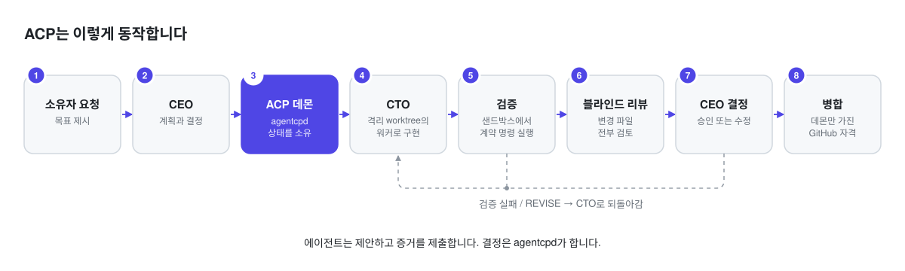
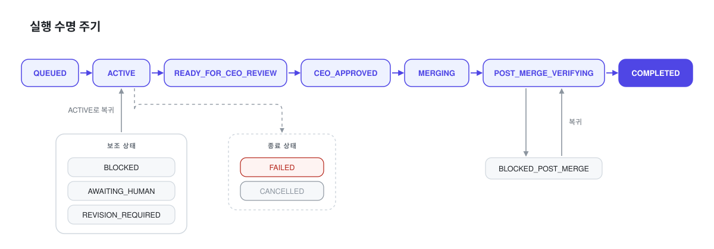

<div align="center">

[English](README.md) · 한국어

<picture>
  <source media="(prefers-color-scheme: dark)" srcset="./assets/readme/acp-logo-dark.svg">
  
</picture>

**에이전트는 제안하고 증거를 냅니다. run, 역할, 검증, 블라인드 리뷰, 머지는 `agentcpd`가 결정합니다.**

</div>

## 개요

Agent Control Plane(ACP)은 로컬 데몬 `agentcpd`와 운영자용 CLI `agentctl`로 이루어져 있으며, AI 코딩 에이전트와 에이전트가 수정하는 저장소 사이에 위치합니다. ACP는 코드를 작성하지 않습니다. 에이전트가 자기 작업에 대해 스스로 내려서는 안 되는 판단을 대신 맡습니다.

- run의 공식 상태: run이 존재하는지, 누가 소유하는지, 끝났는지
- 어떤 세션이 어떤 역할을 맡고 있는지, 그 바인딩이 언제 더 이상 유효하지 않게 되는지
- 쓰기 주체가 어떤 worktree, 브랜치, 경로를 건드릴 수 있는지 (살아 있는 리소스 claim으로 판단)
- 후보(candidate)가 승인된 계약에 따라 샌드박스에서 검증되었는지
- 수정된 모든 파일에 대해 독립적인 블라인드 리뷰를 통과했는지
- 데몬만 접근할 수 있는 GitHub 자격 증명으로 머지해도 되는지

실제 저장소에 AI 에이전트를 돌리는 운영자가 "완료", "테스트 통과", "리뷰 완료"를 모델의 말이 아니라 기록된 증거로 확인하고 싶을 때를 위한 도구입니다. 범용 에이전트 프레임워크, 호스팅 서비스, 채팅 라우터가 아닙니다.

에이전트는 MCP로 데몬과 통신합니다. 데몬은 감독되는 단일 Node 프로세스이고, 로컬 SQLite 데이터베이스 하나를 사용합니다. HTTP 서버, 메시지 브로커, 외부 데이터베이스는 없습니다 ([ADR-0001](docs/adr/ADR-0001-runtime-and-persistence.md)).

## 동작 방식

<picture>
  <source media="(prefers-color-scheme: dark)" srcset="assets/readme/diagrams/how-it-works-ko-dark.svg">
  
</picture>

모든 결정과 상태는 데몬이 가집니다. CEO와 CTO 세션은 각자의 MCP 소켓으로만 데몬에 접근하고, 워커와 리뷰어는 데몬이 띄우는 프로바이더 세션입니다.

### 역할

각 역할은 role key로 지정되고 교체 가능한 세션에 바인딩됩니다. 역할 집합은 [`src/domain/types.ts`](src/domain/types.ts)에 선언되어 있습니다.

| 역할 | 책임 |
|---|---|
| `CEO` | run을 만들고 디스패치하며, CTO 에스컬레이션을 해결하고 최종 결정을 내림 |
| `PRIMARY_CTO` (프로젝트당 1개) | 탐색, 계획과 태스크 그래프, 워커 배정, 통합, CTO 최종 승인 |
| `BOOTSTRAP_CTO` (run당 1개) | `PROJECT_BOOTSTRAP` run을 계획부터 활성화까지 진행 |
| `WORKER` (태스크당 1개) | 일회용 worktree에서 살아 있는 claim 아래 범위가 정해진 태스크 하나를 수행 |
| `BLIND_REVIEWER` (run당 1개) | 새로 만든 격리 세션이 패킷만 보고 수행하는 리뷰. 같은 run의 생산자가 될 수 없음 |
| `OPTIONAL_ADVERSARIAL_REVIEWER` | 선택적인 비블라인드 리뷰 |

오너는 역할이 아닙니다. 오너의 결정은 인증된 ingress로 들어오며, 프로바이더 failover가 오너 권한을 만들어 내는 일은 없습니다.

### run에서 머지까지

1. CEO가 run을 만들고(`run_create`) 디스패치합니다(`run_dispatch`). run의 실행 모드는 `SIMPLE`, `STANDARD`, `GUARDED` 중 하나입니다.
2. CTO가 계획을 제출합니다(`plan_submit`). 워커는 리소스 claim 아래 일회용 worktree에서 작업합니다.
3. 후보가 동결됩니다. 검증 명령은 그 스냅샷과 승인된 계약 digest를 대상으로 seatbelt 샌드박스에서 실행됩니다.
4. 검증이 통과하면 컨트롤 플레인이 직접 블라인드 리뷰를 시작합니다. CTO나 CEO가 이를 요청하거나 건너뛸 수 있는 오퍼레이션은 없습니다.
5. CTO의 최종 승인이 있고 blocker 발견 사항이 없으면 데몬이 production-ready 패킷을 만듭니다. CEO가 `CONFIRM`하면 데몬이 `acp-production-gate`를 게시하고 머지한 뒤 머지 후 검증을 실행합니다.

역할 보유자에게 가는 전달은 내구성이 있습니다. outbox 행을 쓰고, payload 없는 wake를 보내고, 보유자가 자신의 인증된 MCP 연결로 확인 응답(ACK)을 보냅니다. 모든 메시지에는 역할의 바인딩 세대(binding generation)가 실려 있어서, 교체된 세션의 뒤늦은 트래픽은 감사 기록에 남고 폐기됩니다 ([ADR-0003](docs/adr/ADR-0003-role-binding-generation-and-fencing.md)).

<picture>
  <source media="(prefers-color-scheme: dark)" srcset="assets/readme/diagrams/run-lifecycle-ko-dark.svg">
  
</picture>

run은 `QUEUED`, `ACTIVE`, `BLOCKED`, `READY_FOR_CEO_REVIEW`, `CEO_APPROVED`, `MERGING`, `POST_MERGE_VERIFYING`, `BLOCKED_POST_MERGE`, `REVISION_REQUIRED`, `AWAITING_HUMAN`, `COMPLETED`, `FAILED`, `CANCELLED`의 13개 상태를 거칩니다. 그림에서는 덜 일반적인 전이(대부분의 상태에서의 취소, 다음 저장소를 위해 `POST_MERGE_VERIFYING`에서 `MERGING`으로 돌아가는 전이 등)를 생략했습니다. `PROJECT_BOOTSTRAP` run은 `CONFIRM` 시 `READY_FOR_CEO_REVIEW`에서 곧바로 `COMPLETED`가 됩니다.

run 상태와 허용되는 전이는 [`src/db/schema.sql`](src/db/schema.sql)의 `CHECK` 제약과 트리거로 정의되어 있어서, 잘못된 전이는 데이터베이스가 거부합니다.

### 후보 파이프라인

반환된 수정 요청 뒤에는 CTO가 다시 제출합니다. 리뷰를 통과한 후보만 CEO에게 도달하며, CEO는 `CONFIRM`, `FINAL_REVISE`, `OWNER_DECISION_REQUIRED` 중 하나로 답합니다.

### 하드 인바리언트

| ID | 인바리언트 |
|---|---|
| CP-HI-01 | Managed Write Guard: ACP가 소유한 매니페스트, worktree, GitHub 쓰기는 가드를 거침 |
| CP-HI-02 | Single Runtime Authority: 프로젝트 액터는 run을 완료하거나 게이트를 게시하거나 머지할 수 없음 |
| CP-HI-03 | Candidate Contract Pinning: 검증은 승인된 계약 digest와 동결된 후보에 묶임 |
| CP-HI-04 | Independent Quality Role: 블라인드 리뷰어는 같은 run의 생산자가 될 수 없음 |
| CP-HI-05 | Trusted GitHub Credential: 게이트와 머지용 자격 증명에는 데몬만 접근 |
| CP-HI-06 | Exact Evidence: 검증, 리뷰, 게이트, 머지 증거는 같은 후보 스냅샷에 묶임 |
| CP-HI-07 | Non-delegable Human Role: 프로바이더 failover가 오너 권한을 만들어 내지 않음 |
| CP-HI-08 | No Silent Degradation: 누락, 오래됨, 불완전, 격리 안 됨 상태의 증거는 통과로 표시되지 않음 |

각 인바리언트는 위반을 볼 수 있는 가장 낮은 계층에서, 즉 타입이 있는 코드와 데이터베이스 제약으로 강제됩니다 ([ADR-0002](docs/adr/ADR-0002-invariants-as-types-and-constraints.md)). 규범 문서는 [컨트롤 플레인 PRD](docs/prd/AGENT_CONTROL_PLANE_PRD_v1.3_FINAL.md)입니다.

## 요구 사항

- macOS. 검증과 리뷰어 샌드박스는 `sandbox-exec` seatbelt 프로파일을 사용하며, CI의 주요 job은 `macos-15`에서 돌아갑니다.
- Node `^22.18.0 || >=24` ([`package.json`](package.json)의 `engines`). CI는 `22.23.2`를 사용합니다.
- [pnpm](https://pnpm.io/). 설치할 때 `postinstall`이 이 프로젝트의 네이티브 애드온도 빌드하므로([ADR-0010](docs/adr/ADR-0010-native-addon-build-and-load-convention.md)) C/C++ 툴체인이 필요합니다.

## 설치와 빌드

```bash
pnpm install
pnpm rebuild better-sqlite3
pnpm build
```

`pnpm rebuild better-sqlite3`는 pnpm의 빌드 승인 게이트가 이 의존성에 적용되기 때문에 따로 명시적으로 실행하는 단계입니다. 빌드 결과는 `dist/`에 생깁니다. 패키지는 `agentctl`, `agentcpd`, `agentcpd-state` 세 개의 bin을 제공합니다.

## 빠른 시작

먼저 살펴보기만 하는 명령입니다. 데몬이 필요 없습니다.

```bash
node dist/cli/agentctl.js help
node dist/cli/agentctl.js daemon status
```

`ACP_OPERATOR_TOKEN`이 없으면 `daemon status`는 데몬의 락 파일을 읽는 방식으로 대체됩니다.

포그라운드 데몬을 실행하려면 `agentcpd`에 MCP 토큰과 서로 다른 operator 토큰이 필요합니다. 둘 중 하나라도 없거나 값이 같으면 시작을 거부합니다.

```bash
export ACP_MCP_TOKEN="$(openssl rand -hex 32)"
export ACP_OPERATOR_TOKEN="$(openssl rand -hex 32)"
node dist/daemon/agentcpd.js
```

다른 셸에서 `ACP_OPERATOR_TOKEN`을 export한 뒤 `agentctl`을 사용합니다. 자주 쓰는 명령은 다음과 같습니다.

| 명령 | 용도 |
|---|---|
| `agentctl doctor [scope] [target]` | 읽기 전용 상태 점검 |
| `agentctl project register <name> <path>` | 프로젝트와 기본 저장소 등록 |
| `agentctl project list` / `project retire <id> <reason>` | 프로젝트 조회 또는 폐기 |
| `agentctl run list [state]` / `run show <runId>` | run 조회 |
| `agentctl run cancel <runId> <reason>` | run과 그 태스크 그래프 취소 |
| `agentctl run export <runId>` | 호스트에 앵커링된 run 증거 내보내기 |
| `agentctl baseline export --from <ISO> --to <ISO>` | 기간별 증거 baseline 내보내기 |
| `agentctl owner approve <runId> <item>` | 사람 게이트에 대한 오너 결정 기록 |
| `agentctl capacity show` | 프로바이더 용량과 admission |
| `agentctl continuity status` | continuity 모드와 역할 커버리지 |
| `agentctl repair list` / `repair dry-run <op>` / `repair execute <op>` | 허용 목록에 있는 복구 작업 |
| `agentctl daemon status` | 데몬 모드와 상태 |

`node dist/cli/agentctl.js help`는 `binding`, `actor`, `conversation`, `canonical-cto`, `review-evidence` 그룹을 포함한 전체 목록을 출력합니다. `agentctl`은 클라이언트일 뿐입니다. 데이터베이스를 열지 않고 아무것도 결정하지 않으며, 변경 요청은 인증된 operator 소켓을 통해 데몬으로 전달됩니다.

### CEO와 CTO를 위한 MCP 서버

데몬은 상태 디렉터리 안의 오너 전용 Unix 소켓으로 MCP 서버 두 개를 제공합니다.

- CEO 서버(`hermes.mcp.sock`): `run_create`, `run_dispatch`, `run_get`, `run_cancel`, `ceo_decision_submit`, `escalation_resolve`, `owner_decision_submit`, `doctor_run` 등
- CTO 서버(`cto.mcp.sock`): `session_attest`, `contract_get`, `plan_submit`, `resource_claim`, `task_worker_provision`, `task_worker_run`, `task_receipt_submit`, `result_submit`, `escalation_open`, `handoff_submit`, `handoff_ack`, `run_ack`, `role_dispatch_pending`, `role_dispatch_ack`, `capacity_get`, `doctor_run` 등

CTO 서버의 `blind_review_request`는 거부하기 위해서만 존재합니다. 블라인드 리뷰는 컨트롤 플레인이 시작합니다. wake를 받아야 하는 클라이언트는 `--messaging-socket-path`를 상태 디렉터리 바로 안의 소켓으로 지정해 실행합니다. 자세한 내용은 [운영 문서](docs/OPERATIONS.md#starting-a-client-that-can-receive-wakes)를 참고하세요.

## 설정과 상태

상태 루트의 기본값은 `~/.agent-control-plane`이며, `agentctl`은 `ACP_STATE_DIR`로 다른 위치를 지정하는 것을 지원합니다. 이 디렉터리에는 SQLite 데이터베이스(`state.sqlite`, WAL), `health.json`, MCP 소켓, worktree, 용량 기록, secrets 디렉터리가 들어 있습니다. 민감한 상태로 취급하세요. 디렉터리는 오너 전용(`0700`)이고 데이터베이스 파일은 `0600`이며, 프로젝트 체크아웃 안에 두거나 커밋해서는 안 됩니다.

처음 만나게 될 환경 변수입니다.

| 변수 | 의미 |
|---|---|
| `ACP_MCP_TOKEN` | 데몬 MCP 소켓용 자격 증명. `agentcpd`에 필수 |
| `ACP_OPERATOR_TOKEN` | `agentctl`용 자격 증명. `agentcpd`에 필수이며 `ACP_MCP_TOKEN`과 달라야 함 |
| `ACP_OPERATOR_ACTOR` | 호스트의 `USER`가 `owner-identities`에 선언된 액터와 다를 때 쓰는 운영자 신원 |
| `ACP_STATE_DIR` | 상태 루트 재지정. `agentctl`이 읽음 |
| `ACP_BUZZ_SEND_POLICY_FILE` | Buzz 전송 정책 파일의 절대 경로. launchd install과 upgrade에 필요 |

데몬은 오너, 프로바이더, Buzz, Telegram, ingress 설정을 추측하지 않습니다. 선택적 연동은 [`deploy/README.md`](deploy/README.md)에 나열된 launchd Keychain 계정으로 설정합니다.

## 운영

사용자별 launchd job으로 실행합니다.

```bash
pnpm build
security add-generic-password -U -s com.agentcontrolplane.agentcpd -a ACP_MCP_TOKEN -w
security add-generic-password -U -s com.agentcontrolplane.agentcpd -a ACP_OPERATOR_TOKEN -w
export ACP_BUZZ_SEND_POLICY_FILE=/absolute/path/to/buzz-send-policy.json
deploy/install-launchd.sh install --app-root "$(pwd)" --node "$(command -v node)"
```

두 토큰은 Keychain에 두며, 오너 전용 런처가 `agentcpd`를 시작하기 직전에만 가져옵니다. 저장소에 포함된 plist 템플릿을 직접 로드하지 마세요. 설치 스크립트가 호스트별로 렌더링합니다.

```bash
deploy/install-launchd.sh status
deploy/install-launchd.sh restart        # 그 외: start, stop, uninstall
deploy/install-launchd.sh upgrade --app-root /absolute/release --node /absolute/node
deploy/install-launchd.sh rollback --pair-id <uuid> --expected-index-digest sha256:<hex> \
  --expect-schema-version <n> --expect-service-generation <name> --expect-node-version <vX.Y.Z>
```

upgrade는 스키마 마이그레이션 전에 일관된 데이터베이스 백업을 만듭니다. rollback은 봉인된 pair(데이터베이스 백업, 런타임 클로저, launchd 세대)를 하나의 단위로 복원하며, "latest"나 따로 고른 백업은 없습니다. 모든 플래그와 거부 조건은 [`deploy/README.md`](deploy/README.md)에, 오너만 할 수 있는 단계는 [오너 액션](docs/ops/owner-actions.md)에 있습니다.

상태 확인은 `agentctl doctor`를 실행하거나 데몬이 감사 로그에 남긴 최신 리포트를 읽으면 됩니다. 방법은 [운영 문서](docs/OPERATIONS.md#reading-the-doctors-findings)에 있습니다. 컴파일된 프로젝트 bootstrap 계획을 전달하는 절차는 [운영 문서](docs/OPERATIONS.md#supplying-a-compiled-bootstrap-plan)를 참고하세요.

## 보안 모델

- **자격 증명.** GitHub 권한 자격 증명은 모든 프로젝트 저장소 밖의 로컬 시크릿 저장소에 있고 데몬만 읽습니다. CTO, 워커, 리뷰어, 검증 서브프로세스의 환경에는 절대 들어가지 않습니다. MCP 토큰과 operator 토큰은 서로 다르며 plist에 저장되지 않습니다.
- **검증 샌드박스.** 고정된 매니페스트에 선언된 명령만 일회용 worktree에서, 새로 구성한 환경과 시간, 메모리, 출력 제한 아래 실행됩니다. seatbelt 프로파일이 쓰기를 제한하고 기본적으로 네트워크를 막습니다. 격리를 적용할 수 없으면 명령은 실행되지 않습니다 ([ADR-0004](docs/adr/ADR-0004-verification-sandbox-isolation.md)).
- **블라인드 리뷰어.** 리뷰는 패킷만 사용하며, 네트워크 egress는 루프백 프록시를 통해 선택된 프로바이더로만 제한됩니다. 격리 프로브가 실패하면 `ISOLATION_LOST`입니다 ([리뷰어 egress](docs/reviewer-egress.md)).
- **머지 게이트.** 게이트는 이름이 아니라 생성자 신원, payload digest, 정확한 head로 신뢰합니다 ([ADR-0005](docs/adr/ADR-0005-trusted-github-credential-and-gate-provenance.md)).
- **로컬 인터페이스와 ingress.** 소켓은 오너 전용 디렉터리에 있습니다. 오너와 액터의 메시지는 `IngressGuard`가 선언된 신원과 대조해 받아들이며, 재전송 방지가 적용됩니다 ([ADR-0009](docs/adr/ADR-0009-owner-ingress-is-the-front-door.md)).

명시된 잔여 위험과 비공개 취약점 신고 방법은 [docs/SECURITY.md](docs/SECURITY.md)에 있습니다.

## 알려진 한계

- macOS 전용: 샌드박스 강제는 seatbelt 기반이며 Darwin에서만 동작이 검증되었습니다.
- 한 호스트에 로컬 데몬 하나와 SQLite 데이터베이스 하나. HTTP, REST, 웹 인터페이스는 없습니다.
- 데이터베이스 쓰기 가드는 협조적인 프로세스를 전제로 합니다. 같은 OS 사용자로 코드를 실행하는 프로세스는 상태 데이터베이스를 열 수 있습니다.
- 검증 샌드박스의 시크릿 경로 보호는 이름이 지정된 거부 목록이며 최선의 노력(best-effort) 수준입니다. 신뢰할 수 없는 저장소를 위한 경계가 아닙니다.
- `acp-production-gate`를 게시하려면 `checks:write` 권한이 있는 GitHub App 설치가 필요합니다. 개인 액세스 토큰으로는 check run을 만들 수 없습니다.
- 라이선스는 부여되지 않았습니다. [라이선스](#라이선스)를 참고하세요.

## 개발

```bash
pnpm hooks:install   # 이 저장소의 git 훅 연결
pnpm hooks:check     # 각 훅이 이름이 가리키는 경우를 실제로 거부하는지 확인
pnpm gates           # CI 검증 순서를 로컬에서 실행
```

개별 검사:

| 스크립트 | 용도 |
|---|---|
| `pnpm test` | 전체 vitest 실행 (`test:unit`, `test:scenarios`, `test:e2e`는 일부만 실행) |
| `pnpm typecheck` | `tsc --noEmit` |
| `pnpm lint` | `eslint .` |
| `pnpm ci:preflight` | 워크플로의 `pnpm` 명령이 존재하는지, `run:` 단계가 파싱되는지 확인 |
| `pnpm reason-codes` | reason code는 외부 계약이므로 이름 변경이나 삭제를 거부 |
| `pnpm migrations:check` | 한 번 작성된 데이터베이스 마이그레이션은 바뀌면 안 됨 |

CI는 [`.github/workflows/ci.yml`](.github/workflows/ci.yml)입니다. `gates` job이 `pnpm gates --no-tests`를 실행하고, 테스트 샤드가 `pnpm gates --tests-only`를 실행하며, 마지막 `verify` job이 이 모두의 성공을 요구합니다. 게이트 목록은 CI와 `pnpm gates`가 함께 쓰는 단일 매니페스트 [`scripts/lib/prepush-gates.mjs`](scripts/lib/prepush-gates.mjs)입니다.

변경하기 전에 [CONTRIBUTING](docs/CONTRIBUTING.md)을 읽으세요. 강제 로직을 바꾸는 변경에는 그 강제를 제거하면 테스트가 실패한다는 증명을 붙이고, 픽스처나 로컬 테스트를 실제 GitHub, Buzz, Telegram, launchd, 프로바이더 증거로 제시하지 마세요. Pull request는 `pnpm merge <number> --subject <text> --body-file <path>`로 머지합니다.

## 프로젝트 구조

| 경로 | 내용 |
|---|---|
| `src/cli` | `agentctl`과 attach relay |
| `src/daemon` | `agentcpd`와 단일 인스턴스 락 |
| `src/app` | 컨트롤 플레인 구성과 기본 설정 |
| `src/run` | run, 태스크 그래프, 소유자 고정 |
| `src/session`, `src/claims`, `src/guard` | 역할 바인딩, 리소스 claim, Managed Write Guard |
| `src/mcp`, `src/ceo`, `src/cto` | MCP 서버와 CEO, CTO 인터페이스 |
| `src/outbox`, `src/ingress`, `src/buzz` | 내구성 있는 전달, 오너 ingress, Buzz 전송 |
| `src/verify`, `src/review`, `src/quality` | 샌드박스 검증, 블라인드 리뷰, 품질 게이트 |
| `src/github`, `src/git` | GitHub 커널(게이트, 머지, 머지 후 검증)과 git 작업 |
| `src/bootstrap` | 신규 프로젝트 bootstrap과 활성화 |
| `src/capacity`, `src/continuity`, `src/runtime` | 프로바이더 용량, 역할 continuity, 프로바이더 런타임 |
| `src/db`, `src/snapshot`, `src/export` | SQLite 스키마와 마이그레이션, 후보 스냅샷, 증거 내보내기 |
| `src/doctor`, `src/deploy`, `src/telemetry` | 상태 점검과 복구, rollback pair, 텔레메트리 |
| `src/domain`, `src/contracts`, `src/core` | 타입, 계약, 공용 기본 요소 |
| `deploy/`, `native/`, `scripts/`, `tests/` | launchd 설치 스크립트, 네이티브 애드온, 저장소 스크립트, 테스트 |

## 문서

[운영](docs/OPERATIONS.md) · [launchd 배포](deploy/README.md) · [오너 액션](docs/ops/owner-actions.md) · [보안](docs/SECURITY.md) · [리뷰어 egress](docs/reviewer-egress.md) · [용량 소스](docs/capacity-source.md) · [run 증거 내보내기](docs/run-evidence-export.md) · [설계 결정](docs/design-decisions.md) · [ADR](docs/adr/) · [PRD](docs/prd/) · [용어](docs/TERMINOLOGY.md) · [변경 이력](CHANGELOG.md)

## 라이선스

이 저장소는 공개된 라이선스를 부여하지 않습니다. 저장소가 공개되어 있다는 사실이 재사용, 재배포, 배포 사용의 허락을 뜻하지 않습니다. 조건은 [저장소 소유자](https://github.com/MongLong0214)에게 문의하세요.
