<div align="center">

<picture>
  <source media="(prefers-color-scheme: dark)" srcset="./assets/readme/acp-logo-dark.svg">
  
</picture>

<br>

[](https://github.com/MongLong0214/agent-control-plane/actions/workflows/ci.yml)
[](docs/STATUS.md)
[](CHANGELOG.md)
[](package.json)
[](docs/adr/ADR-0004-verification-sandbox-isolation.md)
[](tsconfig.json)
[](docs/adr/ADR-0001-runtime-and-persistence.md)
[](#mcp-surfaces)
[](#license)

**Agents propose and supply evidence. `agentcpd` decides — runs, roles, verification, blind review and the merge.**

[What it is](#what-it-is) · [Why](#why-it-exists) · [How it works](#how-it-works) · [Capabilities](#capabilities) · [Quick start](#quick-start) · [Operate](#operating-it) · [Security](#security-model) · [Docs](#documentation-map) · [Contributing](#contributing) · [License](#license)

</div>

> **Status: not production-ready.** Read [the current status](docs/STATUS.md) before
> attempting to operate or depend on this repository. This page keeps three things apart on
> purpose: what is implemented, what is proven by tests, and what has been observed live. See
> [current limits and evidence](#current-limits-and-evidence).

<h3 align="center">Proven, or refused — never degraded.</h3>

<p align="center">
  <a href="#hard-invariants"><picture>
    <source media="(prefers-color-scheme: dark)" srcset="./assets/readme/acp-invariants-dark.svg">
    
  </picture></a>
</p>

<p align="center"><sub><i>The invariants are the product, not optional policy. Their normative text is §4 of the <a href="docs/prd/AGENT_CONTROL_PLANE_PRD_v1.3_FINAL.md">control-plane PRD</a>; <a href="#hard-invariants">the table below</a> states what each one keeps true.</i></sub></p>

## What it is

Agent Control Plane (ACP) is a local daemon, **`agentcpd`**, and an operator CLI, **`agentctl`**,
that sit between AI coding agents and the repositories they change. ACP does not write code. It
owns the decisions an agent must not make about its own work:

- the **official run state** — whether a run exists, who owns it, and whether it is complete;
- **which session holds which role**, and when that binding stops being current;
- **which worktree, branch and paths** a writer may touch, through live resource claims;
- whether a candidate was **verified** against its approved contract, in a sandbox;
- whether it passed a **mandatory, independent blind review** of every touched file;
- whether it may be **merged**, using a GitHub credential only the daemon can reach.

Agents — a CEO, a project CTO, workers and reviewers — request work and supply evidence over
MCP. The daemon records it, checks it against the same exact candidate, and decides. One
supervised Node process holds all of this in one local SQLite database: no HTTP server, no
message broker, no external database ([ADR-0001](docs/adr/ADR-0001-runtime-and-persistence.md)).

ACP is intended to be a single local runtime authority that, when fully accepted, turns managed
project intent into verified production-ready results. This checkout establishes verifiable
candidate results: it records the run, binds the sessions that may act, freezes the candidate and
contract, verifies it, requires blind review, and records the decision path. It is deliberately
**not** a general autonomous agent framework, a hosted service, an unattended deployment product,
or a chat router.

The normative implementation inputs are the vendored
[control-plane PRD](docs/prd/AGENT_CONTROL_PLANE_PRD_v1.3_FINAL.md) and
[Repo Factory integration PRD](docs/prd/REPO_FACTORY_CONTROL_PLANE_INTEGRATION_PRD_v1.1_FINAL.md).
The [closeout review](docs/review/AGENT_CONTROL_PLANE_v1.0_FINAL_IMPLEMENTATION_CLOSEOUT_REVIEW.md)
is vendored evidence of what remains wrong; it is not hidden history and it is not a passing
acceptance record.

### Roles

Every logical role is addressed by a role key and bound to a replaceable runtime session
([ADR-0003](docs/adr/ADR-0003-role-binding-generation-and-fencing.md)). The role set and its
classes are declared once, in [`src/domain/types.ts`](src/domain/types.ts).

| Role | Role key | Class | Responsibility |
|---|---|---|---|
| `CEO` | `CEO` | authority | Classifies work, sets a run's execution mode and priority, resolves CTO escalations, and gives the final production-ready decision |
| `PRIMARY_CTO` | `PRIMARY_CTO:<projectId>` | producer | Read-only discovery, lean plan and task graph, worker routing, integration, revision, final CTO approval — one per project |
| `BOOTSTRAP_CTO` | `BOOTSTRAP_CTO:<runId>` | producer | Carries a `PROJECT_BOOTSTRAP` run from its PLAN to activation |
| `WORKER` | `WORKER:<taskId>` | producer | One bounded task, in a disposable worktree, under a live claim |
| `BLIND_REVIEWER` | `BLIND_REVIEWER:<runId>` | quality | A fresh, isolated, packet-only review; never a producer of the same run |
| `OPTIONAL_ADVERSARIAL_REVIEWER` | `OPTIONAL_ADVERSARIAL_REVIEWER:<runId>` | producer | Optional non-blind review, counted in the run's producer set |

The **owner** is not a role binding. Owner decisions arrive through authenticated ingress, and
provider failover never invents owner authority (CP-HI-07).

## Why it exists

Every model session can say "done", "tests pass" or "reviewed". None of those sentences is
evidence, and a system that accepts them ends up shipping whatever the most confident session
believed. ACP replaces each such claim with a mechanism:

| The claim an agent can make | What ACP requires instead |
|---|---|
| "The run is complete." | Only `agentcpd` completes a run, publishes the gate or merges (CP-HI-02). |
| "Tests pass." | Verification ran in a sandbox against the frozen candidate and the approved contract digest (CP-HI-03), and failed closed when it could not confine the command ([ADR-0004](docs/adr/ADR-0004-verification-sandbox-isolation.md)). |
| "It was reviewed." | Independence is computed from the bindings recorded for the run, and coverage from the snapshot's touched paths; a `PASS` that omitted a file is downgraded to `COVERAGE_INCOMPLETE` ([ADR-0006](docs/adr/ADR-0006-blind-review-independence-and-coverage.md)). |
| "CI is green; the gate is there." | A gate is trusted by creator identity, payload digest and exact head — not by its name — so a candidate's own CI cannot mint `acp-production-gate` ([ADR-0005](docs/adr/ADR-0005-trusted-github-credential-and-gate-provenance.md)). |
| "I'm still the CTO for this run." | The binding generation is the fence: a replaced session's late results are audited and dropped ([ADR-0003](docs/adr/ADR-0003-role-binding-generation-and-fencing.md)). |
| "There is probably enough capacity." | No `UNKNOWN` route: a stale or failed capacity reading suspends new allocation ([ADR-0007](docs/adr/ADR-0007-provider-capacity-and-continuity.md)). |

## How it works

<p align="center">
  <picture>
    <source media="(prefers-color-scheme: dark)" srcset="./assets/readme/acp-architecture-dark.svg">
    
  </picture>
</p>

1. **Intent becomes a run.** The CEO creates a run (`run_create`) with an execution mode —
   `SIMPLE`, `STANDARD` or `GUARDED` — and dispatches it (`run_dispatch`). Once owned, the run is
   pinned to the owning session and its binding generation.
2. **Roles are bound, not assumed.** A binding attaches a session to a role key with a strictly
   monotonic `bindingGeneration`, enforced by a database trigger. That generation travels on every
   outbox envelope, the run owner pin, every task execution receipt and every managed write request.
3. **Delivery is durable.** The daemon writes an outbox row, wakes the role holder, and the woken
   turn reads and acknowledges its work over its own authenticated MCP connection (below).
4. **The CTO plans; workers build.** `plan_submit` records a lean plan and task graph. Workers
   run in disposable worktrees under live resource claims, and ACP-owned writes pass the Managed
   Write Guard.
5. **The candidate is frozen and verified.** Verification commands run against the frozen
   candidate snapshot and the approved contract digest, in a seatbelt sandbox with a constructed
   environment, its own process group, and time, memory and output limits.
6. **Blind review is automatic.** After verification passes, the control plane invokes a fresh,
   isolated reviewer. There is no CTO- or CEO-facing operation to request or skip it.
7. **The CEO decides; the daemon executes.** With the CTO's final approval and zero blocker
   findings, the daemon assembles the production-ready packet. On the CEO's `CONFIRM`, the
   daemon's finalizer publishes `acp-production-gate`, merges, and runs post-merge verification,
   recording one GitHub receipt per effect.
8. **Evidence stays inspectable.** `agentctl run export <runId>` emits a canonical evidence
   bundle that the producing host can verify authoritatively
   ([run-evidence export](docs/run-evidence-export.md)).

### The run lifecycle

<p align="center">
  <picture>
    <source media="(prefers-color-scheme: dark)" srcset="./assets/readme/acp-run-lifecycle-dark.svg">
    
  </picture>
</p>

The states and their legal edges are a `CHECK` constraint and a transition trigger in
[`src/db/schema.sql`](src/db/schema.sql), so an illegal transition is refused by the database, not
only by the code that asks for it. A run is one of three kinds: `STANDARD_WORK`,
`PROJECT_BOOTSTRAP` or `CONTRACT_CHANGE`.

### Delivery: outbox, wake, ACK

<p align="center">
  <picture>
    <source media="(prefers-color-scheme: dark)" srcset="./assets/readme/acp-delivery-dark.svg">
    
  </picture>
</p>

Retargeting is decided by message kind, not case by case. Role-level intent — `RUN_DISPATCH`,
`TASK_ASSIGN`, `CANCEL_REQUEST`, `CEO_NOTIFICATION` — moves to the new binding; anything addressed
to a specific incarnation, such as a handoff package, is rejected as stale. Redelivering an
in-flight handoff to a different session would produce two CTOs who each believe they own the
same transfer.

### New projects: Repo Factory → genesis → activation

Repo Factory is a separate deliverable and never a second runtime authority. ACP implements only
its side of the bootstrap contract ([ADR-0008](docs/adr/ADR-0008-repo-factory-integration-boundary.md)):

1. **PLAN.** Repo Factory compiles a PLAN carrying an inline genesis bundle
   (`acp.genesis-bundle.v1`): the initial files with their SHA-256 digests, the `main` / `dev` /
   `genesis` branch profile, labels, milestones, issues and product intent. CI workflows must be
   pinned to the genesis files' digests, and the manifest must declare real verification commands.
2. **Attach.** The CEO reviews the exact final bytes and attaches them with
   `bootstrap_plan_attach` and an `expectedSha256`. A current `PRIMARY_CTO` may first stage a
   non-authoritative candidate with `bootstrap_plan_stage`. Attaching is input delivery only: it
   creates no approval and no execution permission.
3. **Submit.** The `BOOTSTRAP_CTO` reads the stored bytes (`bootstrap_plan_get`) and submits by
   digest (`plan_submit`). ACP re-checks the exact-byte hash and the binding context at every step.
4. **Review and genesis.** The bootstrap candidate goes through independent blind review, owner
   approval, the genesis pull request and exact-head CI gates. Where the manifest sets
   `commitlore.mode: required`, the producer runs a pinned CommitLore CLI (`init`, then `doctor`)
   in the new repository, and a failed observation refuses the gate.
5. **Activation.** Only ACP's activation result completes a `PROJECT_BOOTSTRAP` run: project
   registration, local binding, primary CTO binding, Buzz, handoff ACK and doctor. The CEO's
   `CONFIRM` follows the stored activation result. A Repo Factory result that claims activation
   facts itself is rejected (`BOOTSTRAP_RESULT_OVERCLAIMS_ACTIVATION`). The project's
   `PRIMARY_CTO` is always a fresh session, bound at activation, which must acknowledge a
   structured handoff.

The step-by-step operator flow, including replacement and size limits, is in
[operations](docs/OPERATIONS.md#supplying-a-compiled-bootstrap-plan).

## Capabilities

| Capability | What it does | Where |
|---|---|---|
| **Run engine** | Runs, task graphs, owner pinning and the database-enforced state machine | [`src/run`](src/run), [`src/db`](src/db) |
| **Role bindings and fencing** | Monotonic binding generations; failover is one transaction that activates, switches, revokes and retargets | [`src/session`](src/session), [ADR-0003](docs/adr/ADR-0003-role-binding-generation-and-fencing.md) |
| **Outbox, wake and ACK** | Durable, generation-fenced delivery to role holders, with re-wake of pending in-band rows | [`src/outbox`](src/outbox) |
| **Managed Write Guard** | Resource claims and leases on branches, worktrees and paths; grants are consumed immediately before the side effect | [`src/guard`](src/guard), [`src/claims`](src/claims) |
| **Verification engine** | Contract-pinned commands in a seatbelt sandbox; evidence mode `LOCAL_COMMAND`, `TRUSTED_CI` or `BOTH_REQUIRED` | [`src/verify`](src/verify), [ADR-0004](docs/adr/ADR-0004-verification-sandbox-isolation.md) |
| **Blind review gate** | Automatic, packet-only reviewer with mechanical independence and coverage checks and provider-only egress | [`src/review`](src/review), [reviewer egress](docs/reviewer-egress.md) |
| **GitHub kernel** | Pull request preparation, `acp-production-gate` publication, merge, post-merge verification, branch publication and release tagging, each recorded as an idempotent receipt | [`src/github`](src/github), [ADR-0005](docs/adr/ADR-0005-trusted-github-credential-and-gate-provenance.md) |
| **Provider capacity and continuity** | Three orthogonal signals per provider, plan-first failover, restoration that never preempts in-flight work | [`src/capacity`](src/capacity), [`src/continuity`](src/continuity), [ADR-0007](docs/adr/ADR-0007-provider-capacity-and-continuity.md) |
| **Owner ingress** | `IngressGuard` admits the declared owner and actors on Telegram and Buzz, with replay protection | [`src/ingress`](src/ingress), [ADR-0009](docs/adr/ADR-0009-owner-ingress-is-the-front-door.md) |
| **Buzz adapter** | Fenced envelopes over a Nostr-relay transport through the `buzz` CLI, and an authenticated mention subscriber | [`src/buzz`](src/buzz) |
| **Bootstrap activation** | Repo Factory PLAN intake, genesis bundle checks, CommitLore observation, activation and resident CTO handoff | [`src/bootstrap`](src/bootstrap) |
| **Doctor and repair** | Read-only health findings with severity and `blocking`, plus allowlisted repair operations | [`src/doctor`](src/doctor) |
| **Evidence export** | Canonical run and baseline bundles with whole-field redaction, verified against the producing database | [`src/export`](src/export), [run-evidence export](docs/run-evidence-export.md) |
| **Rollback pairs** | Sealed, digest-indexed generations — database, runtime closure and launchd service — restored as one unit | [`src/deploy`](src/deploy), [`deploy/`](deploy/README.md) |

### MCP surfaces

The daemon serves two MCP servers on owner-only Unix sockets in its state directory, and an
operator socket for `agentctl`.

- **CEO server** (`hermes.mcp.sock`) — `run_create`, `run_dispatch`, `run_get`, `run_cancel`,
  `run_priority_set`, `project_get`, `cto_start`, `cto_replace`, `cto_suspend`, `cto_resume`,
  `bootstrap_plan_attach`, `bootstrap_review_evidence_attach`, `bootstrap_review_resume`,
  `ceo_decision_submit`, `escalation_resolve`, `owner_decision_submit`, `repair_execute`,
  `doctor_run`, `continuity_status`, `ceo_notification_ack`, plus `cto_binding_bind` and
  `cto_binding_release` registered by the daemon.
- **CTO server** (`cto.mcp.sock`) — `session_attest`, `contract_get`, `plan_submit`,
  `bootstrap_plan_stage`, `bootstrap_plan_get`, `bootstrap_review_evidence_stage`,
  `resource_claim`, `resource_release`, `task_worker_provision`, `task_worker_run`,
  `task_execution_get`, `task_receipt_submit`, `result_submit`, `escalation_open`,
  `handoff_submit`, `handoff_ack`, `run_ack`, `role_dispatch_pending`, `role_dispatch_ack`,
  `capacity_get`, `doctor_run`, and `blind_review_request`, which exists only to refuse: blind
  review is invoked by the control plane. An admitted `PRIMARY_CTO` connection also gains
  `role_wake_endpoint_register` and the `role_owner_message_*` tools.

## Hard invariants

These are the product, not optional policies. Their normative text is in PRD §4.

| Invariant | What must remain true |
|---|---|
| CP-HI-01 — Managed Write Guard | ACP-owned manifest activation, worktree lifecycle, and GitHub writes pass the Guard; agent source writes are bounded by the assigned disposable worktree, live claim, session/task receipt, and runtime adapter (individual file syscalls are not all Guard API calls). |
| CP-HI-02 — Single Runtime Authority | Project actors cannot independently complete a run, publish an authoritative gate, or merge. |
| CP-HI-03 — Candidate Contract Pinning | Verification is bound to the approved contract digest and frozen candidate, not a mutable replacement. |
| CP-HI-04 — Independent Quality Role | A blind reviewer cannot be a producer for the same run, and the final CEO role is separate. |
| CP-HI-05 — Trusted GitHub Credential | Only the daemon may access the credential for the production gate and programmatic merge. |
| CP-HI-06 — Exact Evidence | Verification, review, gate, and merge evidence bind the same exact candidate snapshot; changed source stales it. |
| CP-HI-07 — Non-delegable Human Role | Provider failover does not invent owner authority. |
| CP-HI-08 — No Silent Degradation | Missing, stale, incomplete, failed, or unisolated evidence must not appear as PASS. |

Each invariant is enforced at the lowest layer that can see the violation — typed code and
database constraints, never a policy engine
([ADR-0002](docs/adr/ADR-0002-invariants-as-types-and-constraints.md)).

## Quick start

This is a development workflow, not a production-install recipe.

**Requirements.** macOS — the verification and reviewer sandboxes use `sandbox-exec` seatbelt
profiles, and the CI `verify` job runs on `macos-15`. Node `^22.18.0 || >=24` as declared in
[package metadata](package.json); CI runs the deployed runtime, `22.23.2`. `pnpm`.

```bash
pnpm install
pnpm rebuild better-sqlite3
pnpm build
pnpm test
pnpm trace
node scripts/ssot-report.mjs
```

`pnpm install` also builds this project's native addons (`native/peercred` is Darwin only and a
no-op elsewhere) through its own `postinstall` script — see
[ADR-0010](docs/adr/ADR-0010-native-addon-build-and-load-convention.md).
`pnpm rebuild better-sqlite3` stays a separate, explicit step because the pnpm build-approval gate
that requires it for that dependency does not apply to this project's own `postinstall`, which
pnpm always runs.

Before a push, run the whole thing CI runs:

```bash
pnpm gates
```

That is the CI `verify` job's gate sequence — every check, in its order, stopping at the first
failure and printing each gate's exit code. The sequence lives in
[`scripts/lib/prepush-gates.mjs`](scripts/lib/prepush-gates.mjs), and the workflow invokes the same
runner. Each gate in it stops a product defect or keeps the commit record intact.

### Inspect without a project mutation

After a build, inspect the CLI surface and the daemon lock:

```bash
node dist/cli/agentctl.js help
node dist/cli/agentctl.js daemon status
node dist/cli/agentctl.js project register my-project /abs/path/to/checkout
node dist/cli/agentctl.js doctor
```

`daemon status` asks the daemon over the operator socket, which needs `ACP_OPERATOR_TOKEN`, and
falls back to the local lock file when the daemon does not answer or no token was given.

### A disposable foreground daemon

`agentcpd` refuses to start without an MCP token and a distinct operator credential, and refuses
if they are the same value:

```bash
export ACP_MCP_TOKEN="$(openssl rand -hex 32)"
export ACP_OPERATOR_TOKEN="$(openssl rand -hex 32)"
node dist/daemon/agentcpd.js
```

The default state root is `~/.agent-control-plane`: the SQLite state, worktrees, capacity
records and secrets directory. Treat it as sensitive local state; never place it in a project
checkout or commit it. The daemon deliberately does not guess its owner, provider, Buzz or ingress
configuration — read [operations](docs/OPERATIONS.md) before configuring any of it.

## Operating it

### Run under launchd

Build the release, put both credentials in the logged-in user's Keychain, then install the
per-user job with the rendering installer
([`deploy/README.md`](deploy/README.md) has every flag and refusal):

```bash
pnpm build
security add-generic-password -U -s com.agentcontrolplane.agentcpd -a ACP_MCP_TOKEN -w
security add-generic-password -U -s com.agentcontrolplane.agentcpd -a ACP_OPERATOR_TOKEN -w
deploy/install-launchd.sh install --app-root "$(pwd)" --node "$(command -v node)"
```

Both tokens are fetched only by the owner-only launcher immediately before it starts `agentcpd`;
neither is stored in the plist or inherited by agent sessions. Do **not** load the checked-in
plist template directly — it carries unresolved deployment values that
`deploy/render-launchd-plist.mjs` fills in per host. The rendered install was verified on a real
host in [#400](https://github.com/MongLong0214/agent-control-plane/issues/400); for any given host,
read its actual state with `deploy/install-launchd.sh status` rather than assuming it.

```bash
deploy/install-launchd.sh status
deploy/install-launchd.sh restart        # also: start, stop, uninstall
deploy/install-launchd.sh upgrade --app-root /absolute/release --node /absolute/node
```

`start` and `restart` report success only after the start writes its completed-start record and
launchd reports the same running pid across a settle window. `upgrade` saves the rendered plist and
launcher, and the database takes a consistent pre-migration backup before any ordered schema step
runs. `uninstall` removes only the LaunchAgent plist and launcher; the database and backups stay.

### Roll back a sealed pair

A rollback restores one **sealed rollback pair**: a UUID-named directory under
`~/.agent-control-plane/rollback-pairs/` holding a WAL-complete database backup, the runtime closure
that reads it, and the launchd generation that starts it, with an exact inventory and a
self-excluding `SHA256SUMS`. There is no `latest` and no separately chosen backup: two
independently selected halves are not a pair.

```bash
deploy/install-launchd.sh rollback --pair-id <uuid> \
  --expected-index-digest sha256:<hex> \
  --expect-schema-version <n> --expect-service-generation <name> --expect-node-version <vX.Y.Z>
```

`--expected-index-digest` is the `SHA256(SHA256SUMS)` retained **outside** the pair, because a pair
that vouches for its own index vouches for a forgery of itself just as readily. Seal a pair with
`node dist/deploy/rollback-pair.js seal …`; the full procedure is in
[owner actions](docs/ops/owner-actions.md).

### Read health and evidence

`agentctl doctor` asks the running daemon for a report over the operator socket, which needs
`ACP_OPERATOR_TOKEN`. The daemon also writes each doctor pass to its audit log, so the latest
report — `status`, and each finding with its `severity` and whether it is `blocking` — can be read
without asking it:

```bash
sqlite3 ~/.agent-control-plane/state.sqlite \
  "select at, evidence_json from audit_events where kind='DOCTOR_REPORT' order by at desc limit 1;"
```

Export evidence without touching the source database:

```bash
node dist/cli/agentctl.js run export <runId>
node dist/cli/agentctl.js baseline export --from <ISO-8601> --to <ISO-8601>
```

A bundle is reproducible, not self-proving: authoritative verification needs the producing
host's database ([run-evidence export](docs/run-evidence-export.md)).

### The authority boundary

`agentcpd` owns authoritative state changes, production-gate publication and programmatic merge.
`agentctl` is only a client: it opens no database and constructs no control plane of its own, and
its mutations reach the lock-held daemon over the authenticated operator socket
([#393](https://github.com/MongLong0214/agent-control-plane/issues/393)). Tools and model sessions
supply requests and evidence; they do not decide that work is complete.

## Security model

| Boundary | How it is held |
|---|---|
| **Credentials** | The GitHub authority credential lives in a local secret store outside every project repository, read only by the daemon, and never placed in the environment of a CTO, worker, reviewer, verification subprocess, Repo Factory, Buzz or Telegram adapter. `ACP_MCP_TOKEN` and `ACP_OPERATOR_TOKEN` are distinct, Keychain-held, and never stored in the plist. |
| **Local surfaces** | MCP and operator sockets live in the owner-only (`0700`) state directory; the database files are mode `0600`. |
| **Verification** | A disposable worktree; a constructed (never inherited) environment with `HOME` and `TMPDIR` in scratch; a seatbelt profile that denies writes outside the worktree and scratch and denies reads of named sensitive paths; network denial when declared; and a captured pid/start-time identity with time, RSS and output limits. If confinement is unavailable, the command does not run. |
| **Blind reviewers** | A composed seatbelt profile denies remote TCP and UDP except one loopback CONNECT proxy port, with a fresh allowlist of the selected provider's endpoints per invocation. Allow, deny and direct-socket probes run before the reviewer may attest; any failure is `ISOLATION_LOST`. |
| **The merge gate** | `merge_evaluate` accepts a gate only when it was created by the trusted identity, its payload digest matches the locally recorded publication, and its head equals the exact head being merged. Branch protection is defence in depth. |
| **Ingress** | Owner decisions and actor messages are admitted by `IngressGuard` against declared identities, with replay protection on inbound messages. |

The executable allowlist for verification commands is defence in depth, not the code-execution
boundary: `node`, `npm`, `npx` and `vitest` are general-purpose interpreters and can exec a shell
after they start. The boundary is the seatbelt and resource sandbox; the inside-shell regression
proof is [`tests/unit/handoff-p1-boundaries.test.ts`](tests/unit/handoff-p1-boundaries.test.ts).
Sandbox read confinement is a named deny list rather than a whitelist, because a blanket read deny
aborts Node at load — a recorded [design decision](docs/design-decisions.md) with its revisit
trigger.

**Stated residuals** ([SECURITY.md](docs/SECURITY.md), [STATUS.md](docs/STATUS.md)):

- The database write guards assume cooperating processes. A code-executing process running as the
  same OS user can open the state database and drop or impersonate the guard functions; mode
  `0600` keeps other users out, and nothing inside SQLite keeps the owning user out.
- Enforcement is behaviourally verified on Darwin only. The Linux hard-memory path has never
  executed in this repository's CI.
- Descendant containment has an observation window: a child created and reparented inside it is
  not seen. This was accepted as a limitation, and the test that exercised it is skipped
  ([#461](https://github.com/MongLong0214/agent-control-plane/issues/461)).
- Do not rely on this repository as a complete security boundary for untrusted repositories or
  unattended deployment.

Report vulnerabilities privately — see [security reporting guidance](docs/SECURITY.md). Do not
post credentials, private repository material or live exploit instructions in a public issue.

## Current limits and evidence

The repository does not claim live acceptance for any path that has not been observed. A closed
prerequisite issue is not a live observation; a record in [`evidence/`](evidence/) is.

- **Recorded live:** a GitHub App gate publication, daemon-finalizer merge and exact post-merge
  verification ([record](evidence/p0-14-live-gate-merge-postmerge.json)), and refusals of an
  untrusted same-named, missing or stale gate read against live GitHub state
  ([record](evidence/p0-14-live-gate-refusals.json)). Production gate publishing needs a GitHub
  App: GitHub does not let personal access tokens create check runs, so `acp-production-gate`
  requires an installation with `checks:write`.
- **Recorded as manual runs:** SIMPLE, STANDARD and GUARDED runs driven through a real cloned
  repository and a live adapter (`evidence/e2e-real-project*.json`). The test that drives them is
  off by default (`ACP_COMPONENT_INTEGRATION=1`), so CI does not catch a regression on that path.
- **Recorded as `PARTIAL`:** Buzz delivery and acknowledgement against the production relay,
  through the installed `buzz` CLI and the deployment's ingress policy — but from an in-memory
  control plane rather than the deployed daemon, so its doctor findings describe that fixture,
  not the host ([record](evidence/p0-09-buzz-live-delivery.json)).
- **Not recorded:** the [1.0.0 changelog](CHANGELOG.md) lists what that release had not done — the
  two-repository merge sequence against real repositories, the three-project, thirty-lifecycle
  observation window, and a Telegram live round trip. No record of any of them is in `evidence/`.
- **Reviewer egress:** packet-only blind reviewers have a measured, fail-closed provider-proxy
  boundary; [SECURITY.md](docs/SECURITY.md) records that its deployment evidence requirement
  remains ([reviewer egress](docs/reviewer-egress.md)).
- **Verification inputs:** a fresh worktree contains only committed files — no `node_modules`, no
  build cache — and with `network: "deny"` it cannot fetch them. A project therefore needs either
  a verification command that needs no installed dependencies (this repository's
  `scripts/verify-reason-codes.mjs` is one), or `evidenceMode: "TRUSTED_CI"`, which accepts CI's
  result only at the exact candidate head from an approved workflow digest.
  `network: "allowlist"` remains unsupported in project manifests.
- **Test coverage meaning:** `pnpm trace` writes [traceability evidence](evidence/traceability.md)
  from the PRD and a fresh Vitest result set. It measures declaration coverage — a labelled leaf
  executed and passed — not behavioural or production-entry-point coverage.
- **Backlog, not shipped:** strong isolation for untrusted repositories, a web dashboard,
  REST/GraphQL and automatic Level 6 routing promotion (PRD §43).

Each live record describes the tree it was captured on, not necessarily the current one. The
boundary map is [current status](docs/STATUS.md); the dependency order and the final program gate
are in the [roadmap](docs/ROADMAP.md).

### Persistence and capacity

State lives in one SQLite database opened with WAL and `synchronous=FULL`, accessed synchronously
inside explicit `BEGIN IMMEDIATE` transactions. Every table beyond the PRD §30.1 names is justified
inline in [`src/db/schema.sql`](src/db/schema.sql) by the lifecycle, integrity constraint or query it
exists for, as §40 requires. A migration, once written, does not change: `pnpm migrations:check`
fails if one does. Event sourcing, an audit hash chain, a generic policy DSL, distributed
consensus and a cloud database are all deliberately absent (§30.4).

Capacity is collected through each provider CLI's interactive `/usage` surface. The collectors
accept only explicit remaining-quota readings and fail closed on a trust prompt, activity-only
output, timeout or parser failure; a daemon JSON mirror is not an operator input. There is no
`UNKNOWN` route. See [provider capacity source](docs/capacity-source.md).

## Where the remaining work lives

The GitHub issue tracker is the single source of truth. Every finding from the independent review
rounds, every PRD §42 acceptance item a build cannot satisfy, every deployment prerequisite and
every deliberate trade-off is an issue — start at the
[tracker index](https://github.com/MongLong0214/agent-control-plane/issues/306) and the
[open issues](https://github.com/MongLong0214/agent-control-plane/issues?q=is%3Aissue%20state%3Aopen).
This page does not copy counts or states from the tracker.
`node scripts/ssot-report.mjs` reconciles the tracker against the review evidence and the declared
work items, and exits non-zero if anything is missing. It checks tracker linkage; it does not
certify the semantic correctness of a code change. See [the acceptance ledger](docs/ACCEPTANCE.md).

## Documentation map

| Read this | For |
|---|---|
| [Current status](docs/STATUS.md) | What is not production-ready, live work still owed, paths CI does not verify |
| [Roadmap](docs/ROADMAP.md) | Dependency order and the final program gate |
| [Operations](docs/OPERATIONS.md) | Local build, inspection, foreground daemon, wake sockets, bootstrap PLAN delivery |
| [launchd deployment](deploy/README.md) | Install, upgrade, rollback pairs, offline project suspension |
| [Owner actions](docs/ops/owner-actions.md) | The steps that need the owner, prepared up to the line |
| [Security](docs/SECURITY.md) | Posture, stated residuals and private reporting |
| [Reviewer egress](docs/reviewer-egress.md) | The provider-only network boundary for blind reviewers |
| [Provider capacity source](docs/capacity-source.md) | How capacity readings become routable |
| [Run-evidence export](docs/run-evidence-export.md) | Bundle format, trust anchor and redaction |
| [CTO binding delegation](docs/cto-binding-delegation.md) | Owner-granted, project-scoped `PRIMARY_CTO` binding authority |
| [Design decisions](docs/design-decisions.md) | Deliberate trade-offs, each with a revisit trigger |
| [ADRs](docs/adr/) | ADR-0001 to ADR-0010: runtime, invariants, fencing, sandbox, credential, review, capacity, Repo Factory, owner ingress, native addons |
| [PRDs](docs/prd/) | The normative control-plane and Repo Factory integration requirements |
| [Closeout review](docs/review/README.md) | The vendored independent implementation review |
| [Acceptance ledger](docs/ACCEPTANCE.md) | Status against PRD §42 and the tracker queries |
| [Terminology](docs/TERMINOLOGY.md) | The source of truth for the contested words |
| [Traceability](evidence/traceability.md) | Requirement → scenario → executable test, generated by `pnpm trace` |
| [Ticket DAG](docs/tickets/tickets.json) | The atomic tickets and their milestones |
| [Changelog](CHANGELOG.md) | What each release is, and what it does not yet do |

## Contributing

Read [contribution guidance](docs/CONTRIBUTING.md) first. In short:

```bash
pnpm hooks:install   # chains this repository's hooks into .git/hooks
pnpm hooks:check     # proves each hook refuses the case it names
pnpm gates           # the CI verify sequence, locally
```

- Tie a change to a tracked finding or documented requirement, and state what live evidence it
  does **not** create.
- A change that claims to add or fix an enforcement carries a **mutation proof**: delete the
  enforcement, show the named test fails for the stated reason, restore it.
- Do not hand-edit generated traceability evidence or status counts. A document that names a
  changing number derives it from a command, query or generated artifact.
- Do not represent a local test, fixture, modelled adapter or template as live GitHub, Buzz,
  Telegram, launchd, provider or owner evidence.
- Commit messages must not carry links to external work-session pages; the `commit-msg` hook and
  `pnpm trailers` refuse them.
- Pull requests are merged with `pnpm merge <number> --subject <text> --body-file <path>`
  ([`scripts/merge-pr.mjs`](scripts/merge-pr.mjs)), which checks the required `verify` run on the
  exact head and preserves commit records that a plain squash merge would drop.

## License

This repository has **no published license grant**. Public visibility must not be read as
permission to reuse, redistribute or deploy it; ask the
[repository owner](https://github.com/MongLong0214) for terms. The checkout intentionally includes
no `LICENSE` file. Release history is in the [changelog](CHANGELOG.md); acceptance and status
history are maintained in [the ledger](docs/ACCEPTANCE.md) and [current status](docs/STATUS.md).

There is no production support or uptime commitment. See
[security reporting guidance](docs/SECURITY.md) and [contribution guidance](docs/CONTRIBUTING.md).
