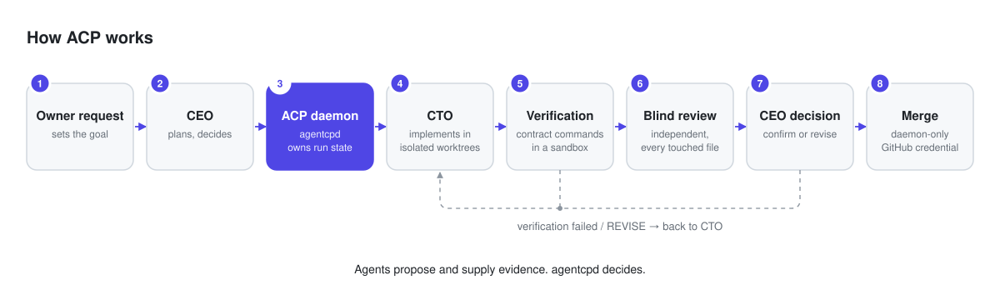

<div align="center">

English · [한국어](README.ko.md)

<picture>
  <source media="(prefers-color-scheme: dark)" srcset="./assets/readme/acp-logo-dark.svg">
  
</picture>

**Agents propose and supply evidence. `agentcpd` decides: runs, roles, verification, blind review and the merge.**

</div>

## What it is

Agent Control Plane (ACP) is a local daemon, `agentcpd`, and an operator CLI, `agentctl`. They sit between AI coding agents and the repositories those agents change. It does not write code. It owns the decisions an agent must not make about its own work:

- the official state of a run: whether it exists, who owns it, whether it is complete;
- which session holds which role, and when that binding stops being current;
- which worktree, branch and paths a writer may touch, through live resource claims;
- whether a candidate was verified against its approved contract, in a sandbox;
- whether it passed a mandatory, independent blind review of every touched file;
- whether it may be merged, using a GitHub credential only the daemon can reach.

It is for an operator who runs AI agents against real repositories and wants "done", "tests pass" and "reviewed" to be recorded evidence, not a model's claim. It is not a general agent framework, a hosted service or a chat router.

Agents talk to the daemon over MCP. The daemon is one supervised Node process with one local SQLite database: no HTTP server, no message broker, no external database ([ADR-0001](docs/adr/ADR-0001-runtime-and-persistence.md)).

## How it works

<picture>
  <source media="(prefers-color-scheme: dark)" srcset="assets/readme/diagrams/how-it-works-dark.svg">
  
</picture>

The daemon owns every decision and all state. CEO and CTO sessions reach it only through their own MCP sockets; workers and reviewers are provider sessions it starts.

### Roles

Each role is addressed by a role key and bound to a replaceable session. The role set is declared in [`src/domain/types.ts`](src/domain/types.ts).

| Role | Responsibility |
|---|---|
| `CEO` | Creates and dispatches runs, resolves CTO escalations, gives the final decision |
| `PRIMARY_CTO` (per project) | Discovery, plan and task graph, worker routing, integration, final CTO approval |
| `BOOTSTRAP_CTO` (per run) | Carries a `PROJECT_BOOTSTRAP` run from its plan to activation |
| `WORKER` (per task) | One bounded task in a disposable worktree under a live claim |
| `BLIND_REVIEWER` (per run) | A fresh, isolated, packet-only review; never a producer of the same run |
| `OPTIONAL_ADVERSARIAL_REVIEWER` | Optional non-blind review |

The owner is not a role. Owner decisions arrive through authenticated ingress, and provider failover never invents owner authority.

### From run to merge

1. The CEO creates a run (`run_create`) and dispatches it (`run_dispatch`). A run has an execution mode of `SIMPLE`, `STANDARD` or `GUARDED`.
2. The CTO submits a plan (`plan_submit`). Workers build in disposable worktrees under resource claims.
3. The candidate is frozen. Verification commands run against that snapshot and the approved contract digest in a seatbelt sandbox.
4. After verification passes, the control plane starts a blind review itself. No CTO or CEO operation requests or skips it.
5. With the CTO's final approval and no blocker findings, the daemon assembles the production-ready packet. On the CEO's `CONFIRM`, the daemon publishes `acp-production-gate`, merges, and runs post-merge verification.

Delivery to role holders is durable: an outbox row that the holder takes and completes over its own authenticated MCP connection; nothing is written into the holder's session. Every message carries the role's binding generation, so a replaced session's late traffic is audited and dropped ([ADR-0003](docs/adr/ADR-0003-role-binding-generation-and-fencing.md)).

<picture>
  <source media="(prefers-color-scheme: dark)" srcset="assets/readme/diagrams/run-lifecycle-dark.svg">
  
</picture>

A run moves through these thirteen states: `QUEUED`, `ACTIVE`, `BLOCKED`, `READY_FOR_CEO_REVIEW`, `CEO_APPROVED`, `MERGING`, `POST_MERGE_VERIFYING`, `BLOCKED_POST_MERGE`, `REVISION_REQUIRED`, `AWAITING_HUMAN`, `COMPLETED`, `FAILED`, `CANCELLED`. The diagram omits the less common edges (for example cancel from most states, and `POST_MERGE_VERIFYING` back to `MERGING` for the next repository). A `PROJECT_BOOTSTRAP` run goes from `READY_FOR_CEO_REVIEW` straight to `COMPLETED` on `CONFIRM`.

Run states and legal transitions are a `CHECK` constraint and a trigger in [`src/db/schema.sql`](src/db/schema.sql), so the database refuses an illegal transition.

### Candidate pipeline

The CTO resubmits after a returned revision. Only a passing review reaches the CEO; the CEO answers `CONFIRM`, `FINAL_REVISE` or `OWNER_DECISION_REQUIRED`.

### Hard invariants

| ID | Invariant |
|---|---|
| CP-HI-01 | Managed Write Guard: ACP-owned manifest, worktree and GitHub writes pass the guard |
| CP-HI-02 | Single Runtime Authority: project actors cannot complete a run, publish a gate or merge |
| CP-HI-03 | Candidate Contract Pinning: verification binds the approved contract digest and the frozen candidate |
| CP-HI-04 | Independent Quality Role: a blind reviewer is never a producer of the same run |
| CP-HI-05 | Trusted GitHub Credential: only the daemon reaches the gate and merge credential |
| CP-HI-06 | Exact Evidence: verification, review, gate and merge evidence bind the same candidate snapshot |
| CP-HI-07 | Non-delegable Human Role: provider failover does not invent owner authority |
| CP-HI-08 | No Silent Degradation: missing, stale, incomplete or unisolated evidence never appears as a pass |

Each invariant is enforced at the lowest layer that can see the violation, in typed code and database constraints ([ADR-0002](docs/adr/ADR-0002-invariants-as-types-and-constraints.md)). The normative text is in the [control-plane PRD](docs/prd/AGENT_CONTROL_PLANE_PRD_v1.3_FINAL.md).

## Requirements

- macOS. The verification and reviewer sandboxes use `sandbox-exec` seatbelt profiles, and CI runs the main job on `macos-15`.
- Node `^22.18.0 || >=24` (`engines` in [`package.json`](package.json)). CI uses `22.23.2`.
- [pnpm](https://pnpm.io/). Installing also builds this project's native addons through `postinstall` ([ADR-0010](docs/adr/ADR-0010-native-addon-build-and-load-convention.md)), so a C/C++ toolchain is needed.

## Install and build

```bash
pnpm install
pnpm rebuild better-sqlite3
pnpm build
```

`pnpm rebuild better-sqlite3` is a separate, explicit step because pnpm's build-approval gate applies to that dependency. The build writes `dist/`. The package exposes three bins: `agentctl`, `agentcpd` and `agentcpd-state`.

## Quick start

Inspect first. These need no daemon:

```bash
node dist/cli/agentctl.js help
node dist/cli/agentctl.js daemon status
```

Without `ACP_OPERATOR_TOKEN`, `daemon status` falls back to reading the daemon's lock file.

To run a foreground daemon, `agentcpd` needs an MCP token and a distinct operator token, and refuses to start if either is missing or they are equal:

```bash
export ACP_MCP_TOKEN="$(openssl rand -hex 32)"
export ACP_OPERATOR_TOKEN="$(openssl rand -hex 32)"
node dist/daemon/agentcpd.js
```

In another shell, with `ACP_OPERATOR_TOKEN` exported, use `agentctl`. Its common commands:

| Command | Purpose |
|---|---|
| `agentctl doctor [scope] [target]` | Read-only health pass |
| `agentctl project register <name> <path>` | Register a project and its primary repository |
| `agentctl project list` / `project retire <id> <reason>` | List or retire projects |
| `agentctl run list [state]` / `run show <runId>` | Inspect runs |
| `agentctl run cancel <runId> <reason>` | Cancel a run and its task graph |
| `agentctl run export <runId>` | Export host-anchored run evidence |
| `agentctl baseline export --from <ISO> --to <ISO>` | Export an evidence baseline for a time window |
| `agentctl owner approve <runId> <item>` | Record an owner decision for a human gate |
| `agentctl capacity show` | Provider capacity and admission |
| `agentctl continuity status` | Continuity mode and role coverage |
| `agentctl repair list` / `repair dry-run <op>` / `repair execute <op>` | Allowlisted repairs |
| `agentctl daemon status` | Daemon mode and health |

`node dist/cli/agentctl.js help` prints the full list, including the `binding`, `actor`, `conversation`, `canonical-cto` and `review-evidence` groups. `agentctl` is only a client: it opens no database and decides nothing. Its mutations go to the daemon over the authenticated operator socket.

### MCP servers for the CEO and CTO

The daemon serves two MCP servers on owner-only Unix sockets in its state directory:

- the CEO server on `hermes.mcp.sock`: `run_create`, `run_dispatch`, `run_get`, `run_cancel`, `ceo_decision_submit`, `escalation_resolve`, `owner_decision_submit`, `doctor_run`, and others;
- the CTO server on `cto.mcp.sock`: `session_attest`, `contract_get`, `plan_submit`, `resource_claim`, `task_worker_provision`, `task_worker_run`, `task_receipt_submit`, `result_submit`, `escalation_open`, `handoff_submit`, `handoff_ack`, `run_ack`, `role_dispatch_pending`, `role_dispatch_ack`, `capacity_get`, `doctor_run`, and others.

## Configuration and state

The state root is `~/.agent-control-plane` by default. `agentctl` honors `ACP_STATE_DIR` to point elsewhere. It holds the SQLite database (`state.sqlite`, WAL), `health.json`, the MCP sockets, worktrees, capacity records and a secrets directory. Treat it as sensitive: the directory is owner-only (`0700`), database files are `0600`, and it must never live inside a project checkout or be committed.

Environment variables you will meet first:

| Variable | Meaning |
|---|---|
| `ACP_MCP_TOKEN` | Credential for the daemon's MCP sockets. Required by `agentcpd` |
| `ACP_OPERATOR_TOKEN` | Credential for `agentctl`. Required by `agentcpd`; must differ from `ACP_MCP_TOKEN` |
| `ACP_OPERATOR_ACTOR` | Operator identity, when the host `USER` is not the actor in `owner-identities` |
| `ACP_STATE_DIR` | State root override, read by `agentctl` |
| `ACP_BUZZ_SEND_POLICY_FILE` | Absolute path of the Buzz send policy; required by launchd install and upgrade |

The daemon does not guess its owner, provider, Buzz, Telegram or ingress configuration. Optional integrations are configured through the launchd Keychain accounts listed in [`deploy/README.md`](deploy/README.md).

## Operations

Run it as a per-user launchd job:

```bash
pnpm build
security add-generic-password -U -s com.agentcontrolplane.agentcpd -a ACP_MCP_TOKEN -w
security add-generic-password -U -s com.agentcontrolplane.agentcpd -a ACP_OPERATOR_TOKEN -w
export ACP_BUZZ_SEND_POLICY_FILE=/absolute/path/to/buzz-send-policy.json
deploy/install-launchd.sh install --app-root "$(pwd)" --node "$(command -v node)"
```

Both tokens live in the Keychain and are fetched only by the owner-only launcher just before `agentcpd` starts. Do not load the checked-in plist template directly; the installer renders it per host.

```bash
deploy/install-launchd.sh status
deploy/install-launchd.sh restart        # also: start, stop, uninstall
deploy/install-launchd.sh upgrade --app-root /absolute/release --node /absolute/node
deploy/install-launchd.sh rollback --pair-id <uuid> --expected-index-digest sha256:<hex> \
  --expect-schema-version <n> --expect-service-generation <name> --expect-node-version <vX.Y.Z>
```

Upgrade takes a consistent database backup before any schema migration. Rollback restores one sealed pair (database backup, runtime closure and launchd generation) as a unit; there is no "latest" and no separately chosen backup. Every flag and refusal is in [`deploy/README.md`](deploy/README.md), and the owner-only steps are in [owner actions](docs/ops/owner-actions.md).

For health, run `agentctl doctor`, or read the latest report the daemon wrote to its audit log; [operations](docs/OPERATIONS.md#reading-the-doctors-findings) shows how. Supplying a compiled project bootstrap plan is described in [operations](docs/OPERATIONS.md#supplying-a-compiled-bootstrap-plan).

## Security model

- **Credentials.** The GitHub authority credential is held in a local secret store outside every project repository and is read only by the daemon. It is never placed in the environment of a CTO, worker, reviewer or verification subprocess. The MCP and operator tokens are distinct and not stored in the plist.
- **Verification sandbox.** Only the pinned manifest's declared commands run, against a disposable worktree, with a constructed environment and time, memory and output limits. A seatbelt profile confines writes and, by default, denies network access. If confinement is unavailable, the command does not run ([ADR-0004](docs/adr/ADR-0004-verification-sandbox-isolation.md)).
- **Blind reviewers.** Review is packet-only, with network egress limited to the selected provider through a loopback proxy. A failed isolation probe is `ISOLATION_LOST` ([reviewer egress](docs/reviewer-egress.md)).
- **Merge gate.** A gate is trusted by creator identity, payload digest and exact head, not by its name ([ADR-0005](docs/adr/ADR-0005-trusted-github-credential-and-gate-provenance.md)).
- **Local surfaces and ingress.** Sockets sit in an owner-only directory. Owner and actor messages are admitted by `IngressGuard` against declared identities, with replay protection ([ADR-0009](docs/adr/ADR-0009-owner-ingress-is-the-front-door.md)).

Stated residuals and private vulnerability reporting are in [docs/SECURITY.md](docs/SECURITY.md).

## Known limits

- macOS only: sandbox enforcement is built on seatbelt and is behaviorally verified on Darwin only.
- One local daemon and one SQLite database on one host. There is no HTTP, REST or web interface.
- The database write guards assume cooperating processes: a code-executing process running as the same OS user can open the state database.
- The verification sandbox's secret-path protection is a named deny list and is best-effort; it is not a boundary for untrusted repositories.
- Publishing `acp-production-gate` requires a GitHub App installation with `checks:write`; personal access tokens cannot create check runs.
- No license is granted; see [License](#license).

## Development

```bash
pnpm hooks:install   # chain this repository's git hooks
pnpm hooks:check     # prove each hook refuses the case it names
pnpm gates           # the CI verification sequence, locally
```

Individual checks:

| Script | Purpose |
|---|---|
| `pnpm test` | Full vitest run (`test:unit`, `test:scenarios` and `test:e2e` run the parts) |
| `pnpm typecheck` | `tsc --noEmit` |
| `pnpm lint` | `eslint .` |
| `pnpm ci:preflight` | Checks workflow `pnpm` commands exist and `run:` steps parse |
| `pnpm reason-codes` | Reason codes are an external contract; refuses renamed or removed ones |
| `pnpm migrations:check` | A written database migration must not change |

CI is [`.github/workflows/ci.yml`](.github/workflows/ci.yml). A `gates` job runs `pnpm gates --no-tests`, test shards run `pnpm gates --tests-only`, and a final `verify` job requires all of them. The gate list is the single manifest [`scripts/lib/prepush-gates.mjs`](scripts/lib/prepush-gates.mjs), shared by CI and `pnpm gates`.

Before a change, read [CONTRIBUTING](docs/CONTRIBUTING.md). Give an enforcement change a proof that its test fails when the enforcement is removed, and never present a fixture or local test as live GitHub, Buzz, Telegram, launchd or provider evidence. Pull requests are merged with `pnpm merge <number> --subject <text> --body-file <path>`.

## Project layout

| Path | Contents |
|---|---|
| `src/cli` | `agentctl` and the attach relays |
| `src/daemon` | `agentcpd` and single-instance locking |
| `src/app` | Control plane composition and default configuration |
| `src/run` | Runs, task graphs, owner pinning |
| `src/session`, `src/claims`, `src/guard` | Role bindings, resource claims, Managed Write Guard |
| `src/mcp`, `src/ceo`, `src/cto` | MCP servers and the CEO and CTO surfaces |
| `src/outbox`, `src/ingress`, `src/buzz` | Durable delivery, owner ingress, Buzz transport |
| `src/verify`, `src/review`, `src/quality` | Sandboxed verification, blind review, quality gates |
| `src/github`, `src/git` | GitHub kernel (gate, merge, post-merge) and git operations |
| `src/bootstrap` | New-project bootstrap and activation |
| `src/capacity`, `src/continuity`, `src/runtime` | Provider capacity, role continuity, provider runtimes |
| `src/db`, `src/snapshot`, `src/export` | SQLite schema and migrations, candidate snapshots, evidence export |
| `src/doctor`, `src/deploy`, `src/telemetry` | Health findings and repairs, rollback pairs, telemetry |
| `src/domain`, `src/contracts`, `src/core` | Types, contracts, shared primitives |
| `deploy/`, `native/`, `scripts/`, `tests/` | launchd installer, native addons, repository scripts, tests |

## Documentation

[Operations](docs/OPERATIONS.md) · [launchd deployment](deploy/README.md) · [Owner actions](docs/ops/owner-actions.md) · [Security](docs/SECURITY.md) · [Reviewer egress](docs/reviewer-egress.md) · [Capacity source](docs/capacity-source.md) · [Run-evidence export](docs/run-evidence-export.md) · [Design decisions](docs/design-decisions.md) · [ADRs](docs/adr/) · [PRDs](docs/prd/) · [Terminology](docs/TERMINOLOGY.md) · [Changelog](CHANGELOG.md)

## License

This repository has no published license grant. Public visibility is not permission to reuse, redistribute or deploy it; ask the [repository owner](https://github.com/MongLong0214) for terms.
